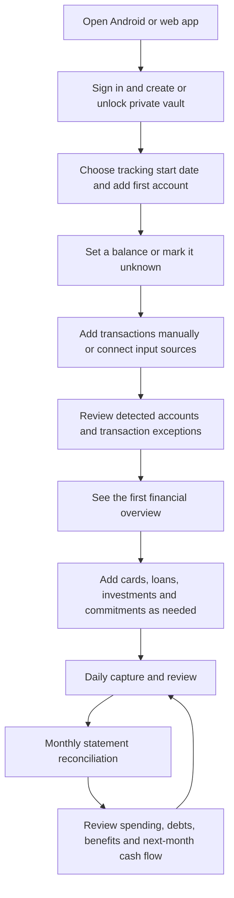

# Financial Management — User Journeys and Product Specification

Status: proposed product specification, based on the agreed requirements and supplied financial records.

This document describes the financial application from the user's perspective, including inputs, screens, automation, review, implementation behavior, and acceptance criteria. It is the financial-management companion to [APPLICATION_PLAN.md](APPLICATION_PLAN.md). **NBR-compatible expenditure classification, supporting asset-acquisition records, and expenditure summaries are part of this release.** Taxpayer identity setup, tax-liability calculations, full return preparation, and filing remain outside this document. Spending must be captured in a form suitable for a later return from the beginning.

Reading order: [experience](#1-the-experience-we-are-building) → [screens](#2-navigation-and-daily-screens) → [onboarding](#3-onboarding-what-the-user-must-enter) → [product inputs](#4-product-forms-exact-information-to-collect) → [capture](#5-bringing-transactions-into-the-application) → [review](#6-reviewing-activity-and-keeping-accounts-accurate) → [products](#7-financial-products-and-commitments) → [charges and benefits](#8-charges-waivers-cashback-and-rewards) → [daily/monthly use](#9-daily-use-planning-and-the-monthly-journey) → [sync and recovery](#10-continuing-on-another-device-and-protecting-my-work) → [walkthrough](#11-a-concrete-first-month-walkthrough) → [implementation](#12-implementation-structure-and-delivery-order) → [acceptance](#13-acceptance-and-verification-checklist) → [remaining configuration](#14-defaults-and-information-still-needed-for-implementation).

## 1. The experience we are building

The user should be able to say: **“My financial activity comes into one place. I correct what needs attention, see what I have and owe, and know what is coming next.”**

The application combines transactions, supporting evidence, financial products, and future commitments. Users work with familiar actions such as buying something, transferring money, paying a bill, receiving salary, lending money, or recording an investment. Bookkeeping entries and synchronization machinery stay behind those actions.

### End-to-end journey

### What counts as a successful first session

The user has one account, an explicit balance status, at least one recorded or reviewed transaction, and an understandable overview. They do not have to enter all accounts, connect their inbox, upload years of history, or configure every financial product before using the app.

The overview is useful with partial information but must clearly identify missing balances, incomplete history, and unresolved transactions.

### Shared product defaults

| Decision | Initial behavior |
|---|---|
| Users | One owner and one personal financial space; this is not a public multi-user release |
| Platforms | Android and responsive web with the same financial features |
| Currency and dates | BDT and Asia/Dhaka by default; confirm during setup |
| Storage | Encrypted Firebase synchronization and optional encrypted Drive backups |
| Credential storage | Google Password Manager or Apple Passwords as the user's primary choice; both can serve the same application profile |
| Expense categories | Official NBR expenditure heads with explicitly mapped detail categories; no invented official report heads |
| Processing | Financial parsing and calculations on unlocked devices |
| Email provider | Gmail initially; other providers are an extension, not silently assumed supported |
| Automation | Known unambiguous events are handled automatically; ambiguous events need review |
| Inputs | Manual entries, Android SMS, SMS XML files, emails, PDF statements, receipt images, and supported workbook migration |
| Actions | Tracking and planning; the app does not execute payments or contact banks or borrowers |
| Terminology | Separate actual money movements, scheduled commitments, and hypothetical plans |

## 2. Navigation and daily screens

| Screen | What the user sees and does |
|---|---|
| Home | Cash and bank balances, card/loan debt, upcoming payments, review tasks, and recent activity |
| Activity | Searchable transactions; add, assign NBR expenditure heads, split, link, correct, or inspect evidence |
| Accounts | Banks, MFS, cash, prepaid accounts, cards, balances, and statement history |
| Commitments | Loans, EMIs, bills, subscriptions, borrowing, and their due dates |
| Assets & Lending | Investments, deposits, savings certificates, retained assets such as electronics/furniture, money lent, and expected receipts |
| Planning | Budgets, cash-flow calendar, savings targets, purchase scenarios, and an NBR expenditure summary |
| Inbox & Review | Imports, source connections, unresolved extraction, duplicates, mismatches, and category questions |
| Settings | Categories and rules, security, devices, backup, exports, and source permissions |

Android uses a compact navigation bar for Home, Activity, Accounts, and More, with a persistent Add action. Web uses a sidebar, wide tables, bulk review, and a side-by-side evidence panel. Every financial action remains available on both; direct phone SMS access is Android-specific.

Home and each account show a visible "as of" time. Last source check, last successful reconciliation, and synchronization status are separate facts.

## 3. Onboarding: what the user must enter

### Short setup versus progressive setup

Required setup is limited to securing the financial space, confirming preferences, and adding the first account. Income, products, balances, historical documents, and automation can be completed progressively. The app seeds the verified NBR expenditure catalog; the user confirms reporting-period dates before generating a complete NBR summary. No NID, TIN, employer certificate, bank password, card PIN, CVV, or full card number is required.

### Onboarding sequence

| Step | User input | Required now? | Result |
|---|---|---|---|
| 1. Enter | Google sign-in; choose new financial space or restore existing data | Yes | Identify the owner and prevent accidental creation of a second vault |
| 2. Secure | Choose Google Password Manager or Apple Passwords; save a vault passphrase or supported vault-unlock passkey; test retrieval/unlock; save and confirm recovery key | Yes for a new vault; offer saved-passphrase fallback when passkey-based decryption is unsupported | Enable encrypted records, manager-assisted access, and recovery |
| 3. Preferences | Confirm BDT, timezone, and preferred monthly budget start day; review the seeded NBR expenditure catalog and reporting-period dates | Currency/timezone yes; budget day defaults to 1; NBR period confirmation required before a complete expenditure summary | Set financial defaults and source-backed expenditure reporting |
| 4. Starting point | Track from today or choose a historical start date | Yes | Define which activity contributes to tracked balances |
| 5. First account | Account type, institution when applicable, nickname, currency, and opening-balance status | Yes | Create the first place to record money or debt |
| 6. Balance | Known opening amount and boundary date, verified statement opening balance, or "I don't know yet" | Explicit choice yes; amount can wait | Avoid representing missing information as zero |
| 7. First activity | Add one transaction, upload a file, connect SMS/email, or skip | Optional | Begin recording activity |
| 8. Other finances | Select relevant cards, loans, lending, deposits, investments, and bills | Optional | Build a tailored setup checklist |
| 9. Summary | Review accounts and balances, source access, and outstanding setup tasks | Yes | Open Home with a clear picture of completeness |

"Track from today" means start-of-day at the selected local date. Explain this beside the balance field: **“Balance immediately before transactions on this date.”** If the user only knows the balance right now, offer the current-balance checkpoint workflow instead of silently using it as the opening balance.

### US-01 — Create and secure my financial space

**Story:** As a new user, I want to create a private financial space so I can use the same records on my phone and browser.

**Experience:** Welcome → Continue with Google → Create private space → Choose Google Password Manager or Apple Passwords → Save vault passphrase or a supported vault-unlock passkey → Test saved access → Save and confirm recovery key. Display the app's Google account email beside the credential label. For Google Password Manager, guide the user to save under that same Google account. For Apple Passwords, explain that storage is in their Apple account/iCloud while the app profile remains the same Google-signed-in profile. Offer biometric unlock on Android after setup. The user may add the other manager later.

**Implementation:** Google authentication establishes identity; device-side encryption protects financial contents. Integrate Android Credential Manager and web password autofill/WebAuthn with the app's stable domain. Passphrase forms support browser/password-manager saving without submitting the secret to the application backend. Bind app-specific passkey public credentials to the existing owner UID after authenticated enrollment. A normal passkey authenticates; vault decryption additionally requires a supported client-side PRF/key-wrapping flow. Feature-test that capability and offer the saved-passphrase/recovery path when unavailable. Store a separately wrapped vault key per supported unlock credential; never derive a decryption key from a passkey signature or public key. Persist setup progress as encrypted drafts. If an existing vault is found, offer unlock or restore rather than another blank space.

**Acceptance:** Google Password Manager and Apple Passwords each support a tested primary save/retrieve path on supported platforms. A second device opens the same space after sign-in and unlocking. An unsupported PRF response cannot lock the user out or claim a passkey can decrypt the vault. Recovery works without the original phone. Canceling a manager prompt keeps setup resumable; manual unlock remains available. Dismissing an optional biometric prompt does not interrupt setup. The application backend never receives plaintext passphrases, recovery keys, private passkey material, PRF outputs, or unwrapped vault keys.

**Platform boundary:** The password manager and user control the provider and storage account. The app can label credentials with its Google profile, guide account selection, and test retrieval; it cannot silently force or independently verify the manager's Google account. Record any same-account confirmation as user-confirmed, not API-verified. Apple Passwords cannot store an iCloud credential inside a Google account. Allowing either manager as primary is the user's selected resolution of that distinction. Password-manager cloud synchronization is performed by the chosen provider with user consent, separate from encrypted app-data synchronization.

Show only provider paths supported on the current device/browser, with instructions for other devices; do not promise a native Apple Passwords picker on Android. A passkey-only vault may have no passphrase wrapper: on an unsupported-PRF device, require the tested recovery key or an already unlocked device, then offer enrollment of a saved passphrase or another compatible credential. Offer a passphrase fallback only when one was actually enrolled. Test both manager-assisted retrieval and cross-device decryption, not just successful passkey registration.

### US-02 — Choose how far back to track

**Story:** As a new user, I want to choose a manageable starting point without reconstructing my whole financial life.

**Experience:** Choose "Start today" or "Bring in earlier activity." Historical users select a date and see the required opening balances. The app explains that older documents may still be stored as reference evidence.

**Implementation:** Store a default tracking boundary, with account-specific boundaries when an account has different evidence coverage. Documents before that boundary remain reference-only unless the user explicitly extends the account's history. Extending history previews the replacement opening position and affected reports before confirmation.

**Acceptance:** Older imported transactions cannot change current balances twice. A missing opening amount remains unknown. Changing the boundary cannot silently rewrite a reconciled period.

### US-03 — Add my first account and establish its balance

**Story:** As a user, I want to add the account I use most and know whether its displayed balance is reliable.

**Experience:** Choose Bank/MFS/Cash/Prepaid → institution if applicable → nickname → optional masked identifier → balance setup. Offer "Opening balance at start," "Use statement," "I know today's balance," and "Unknown." Unknown accounts can still receive transactions and show activity totals.

**Implementation:** Record known opening balances as opening entries, not income. A current balance is a dated checkpoint. It becomes an anchor only after movements between the tracking boundary and checkpoint are complete or an explicit opening adjustment is reviewed. Do not derive an opening balance from an incomplete SMS history.

**Acceptance:** A Tk 20,000 opening balance plus a Tk 1,000 purchase produces Tk 19,000, with no Tk 20,000 income. Unknown balances do not appear as zero in totals. A mismatch offers review or an explicit adjustment with a reason, never an invisible correction.

### US-04 — Finish quickly and resume setup later

**Story:** As a user, I want to start using the application before entering every product and historical document.

**Experience:** Home opens with a checklist such as "Add your other accounts," "Confirm one balance," and "Import transactions." Tasks are relevant to selected products and can be postponed. Existing balances and entries stay usable.

**Implementation:** Save each completed step independently. Setup status is separate from account verification and transaction reconciliation. Ask for source and notification permissions only when the user activates those features.

**Acceptance:** Denying SMS/email access leaves manual entry and document import available. Closing the app resumes at the saved step. Completing onboarding does not label incomplete finances as verified.

## 4. Product forms: exact information to collect

These forms appear when the user adds the relevant product, not as one long onboarding questionnaire. A source may prefill fields, but the user confirms ownership, identity, and starting balances before activation.

| Product | Minimum fields to activate | Optional or later | What the app derives |
|---|---|---|---|
| Bank/MFS/prepaid account | Type, institution, nickname, currency, tracking boundary, balance known/unknown | Masked identifier, full account number if needed for documents, branch, opening date | Balance from confirmed opening plus posted movements |
| Cash wallet | Nickname, currency, boundary, balance known/unknown | Purpose or location | Tracked cash balance and movements |
| Debit card | Nickname, issuing institution, linked account, last four digits if available | Network, expiry month/year, product fees | Activity through the linked account; no second cash balance |
| Credit card | Institution, product/nickname, currency, tracking boundary, opening debt known/unknown | Last four digits, limit, statement closing day, due-date rule or next explicit due date, annual-fee date, statement, minimum due, benefits policy | Purchases and payments immediately; outstanding liability when anchored; statement due and available credit when their inputs are known |
| New institutional loan | Lender, disbursement date, principal, receiving account, repayment terms, first due date | Interest method/rate, upfront fees, agreement, recurring debit account | Schedule, interest/principal allocation, projected payoff and total cost |
| Existing loan | Lender, balance date, outstanding principal known/unknown | Next due date, known installment or lender schedule, original principal/date, past payments, rate, fees, agreement | Remaining schedule where inputs suffice; otherwise position tracking and amount/date reminders when entered |
| Card installment plan | Parent card, underlying purchase/loan link, financed principal, start date, installment count and amount or complete rate terms | Conversion fee, lender schedule, first statement date | Remaining principal and installment commitments inside card debt |
| Money lent or borrowed | Direction, counterparty label, date, original amount or current outstanding, currency, funding account or opening-position choice | Expected repayment date, interest agreement, proof, notes | Receivable/payable balance, repayments, overdue status when due date exists |
| FDR | Institution, principal/current position, start date, maturity date, funding link or opening-position choice | Rate, compounding/payout terms, withholding, renewal instruction, nominees, proof | Expected maturity/payouts when terms are known; actual receipts separately |
| DPS | Institution, installment amount, schedule, start date, maturity date, current accumulated principal or payment history | Rate, missed-payment terms, debit account, nominees, proof | Due installments, posted contributions, outstanding dues, expected maturity if calculable |
| Savings certificate | Type, issuer, face value/current position, issue date, maturity date, funding link or opening-position choice | Payout terms, joint holder, nominees, withholding, certificate proof | Principal position, payout reminders, expected and actual returns |
| Other investment | Organization/type, principal, investment date, funding link or opening-position choice | Expected return date/amount, distributions, fees, proof, valuation | Principal invested, actual returns, expected proceeds and supplied valuations separately |
| Retained personal asset | Description/type, acquisition or existing-position choice, acquisition/as-of date, cost known/unknown, ownership share, NBR asset treatment or pending review | Funding transaction, invoice/proof, serial/model, later valuation | Linked acquisition cost, dated holdings, refunds/disposals, and asset additions separately from lifestyle expenses |
| Recurring bill/subscription | Name, amount or variable amount, frequency, next due date | Category, paying account/card, end date, reminder preference | Due calendar and forecast; no payment is assumed |
| Expected salary/income | Label, expected amount, frequency, expected date | Receiving account, employer/payer label | Forecast receipts and expected-versus-received comparison |
| Fee/benefit policy | Product link, policy type, effective period, required terms for evaluation | Official terms/document, claim instructions, notes | Progress and expected charge/benefit when terms are complete |

For an existing product, offer two explicit paths: **“Record its current position”** or **“Reconstruct from its original transaction.”** Never add a historical disbursement or purchase on top of a current opening position for the same principal.

If an account or card identifier is incomplete, keep matching tentative. The same last four digits can occur on different products. Institution, currency, product type, and user confirmation also matter.

## 5. Bringing transactions into the application

### Shared input and processing contract

| Stage | User-visible behavior | Implementation behavior |
|---|---|---|
| Capture | See source, account, date range, and progress | Create an import batch or source observation with stable identifiers |
| Extract | See detected facts beside the source | Parse into candidate events; preserve original wording and location |
| Resolve account | Confirm a detected account or pick an existing one | Never automatically create an active owned account from an alert |
| Match | See existing transaction links or duplicate questions | Check repeated imports and cross-source evidence before posting |
| Classify | See financial action and category suggestion | Apply established rules; retain confidence, provenance, and overrides |
| Post/review | See recorded events separately from items needing attention | Post complete unambiguous actual events; stage uncertain amounts, ownership, or status |
| Reconcile | See statement coverage and balance checks | Compare posted entries with authoritative period evidence |

A posted transaction may still need a category. Category uncertainty must not conceal a known cash movement. Uncertain amount, direction, ownership, or completion status prevents posting until resolved. These are different problems and must have different review actions.

### Review priority and visible states

The review screen puts monetary problems first: unknown account or amount, conflicting events, missing statement lines, and unresolved transfers. Category questions follow. A task states the problem, affected amount/account when known, supporting evidence, and a concrete next action. "Ignore" requires an explicit reason and leaves an audit record; ignoring a monetary discrepancy does not make reconciliation pass.

| Status dimension | Example shown to the user | Meaning |
|---|---|---|
| Source processing | Captured / Couldn't read / Partially read | Whether the source was extracted successfully |
| Transaction outcome | Pending / Completed / Failed / Reversed | Whether the economic movement occurred |
| Posting | Needs confirmation / Recorded | Whether the movement affects actual balances |
| Category review | Uncategorized / Suggested / Confirmed | Whether the spending explanation is resolved |
| Reconciliation | Not checked / Matched / Difference found | Agreement with specific statement evidence |
| Commitment | Upcoming / Part-paid / Paid / Overdue / Skipped | Fulfillment of a particular scheduled obligation |
| Source coverage | Last checked / Missing dates / Complete for this statement | Scope of evidence available; not a promise that every real-world event is captured |

Each screen shows only the relevant status dimensions in plain language. An uncategorized, recorded, completed purchase can still be statement-matched. A successfully parsed reminder can still have no payment recorded.

### US-05 — Record a transaction manually

**Story:** As a user, I want to record cash or missing activity immediately.

**Experience:** Add → choose Expense, Income, Transfer, Repayment, Lending, or Investment → choose account → amount → date/time → category or purpose → Save. Default date to now and offer the last-used account. Counterparty, notes, and evidence are optional. Loan/investment actions open their focused forms.

**Implementation:** Validate positive amounts, currency, account ownership, and splits. Create the necessary balanced ledger postings as one operation. Users never need to enter bookkeeping debits/credits.

**Acceptance:** Saving offline works. A double tap creates one record. Income is distinct from loan proceeds, refunds, and repayment of money lent. A later imported alert can attach to the manual record.

**Net receipts and deductions:** Add → Income/Return received → record net receipt and, when available, gross amount plus separately identified deductions. Accept payslip, interest/profit certificate, or manual deduction evidence with purpose, date, and payer. Reconcile gross minus deductions to the single bank receipt. A Tk 50,000 gross salary with Tk 1,000 withholding and Tk 49,000 bank credit produces one Tk 49,000 bank movement plus a distinct evidenced deduction; importing the bank alert later must not record the salary twice. Missing gross/deduction evidence stays a reporting review issue. Withholding is not inferred from the gap unless the deduction purpose is established, and VAT is not assumed to be withholding.

### US-06 — Import historical SMS messages

**Story:** As a user, I want my existing bank and payment alerts to become a usable activity history.

**Experience:** Inbox & Review → Import → SMS backup XML → choose date range and financial senders → preview detected accounts and event counts → confirm import. Summary separates recorded events, linked duplicates, ignored messages, and issues. Nonfinancial messages are excluded from the saved financial evidence by default.

**Implementation:** Parse safely with external entities disabled. Preserve sender, message timestamp, source transaction reference, and parser version. Scope duplicate identity to the source message and cross-check economic events; identical text alone is not proof of duplication.

**Acceptance:** Reimporting a backup creates no extra movements. Two legitimate same-amount payments stay distinct. Unparsed messages are visible and can be converted manually, reprocessed, or marked irrelevant. OTPs and promotional messages do not become transactions.

### US-07 — Capture new financial SMS on Android

**Story:** As an Android user, I want new financial alerts captured without entering every transaction myself.

**Experience:** Enable SMS capture in Sources → read the permission explanation → grant permission → select relevant senders/accounts → preview a sample. Home reports the last successful check and any pending review. Revocation produces a reconnect prompt rather than losing existing records.

**Implementation:** Use Android-specific SMS access behind an input adapter. While locked, defer private processing and retain message references for catch-up. Re-scan from the saved checkpoint after unlock or interruption. Preserve XML import as the fallback. Direct SMS capture on web is not offered; the web sees encrypted records synchronized from Android.

**Acceptance:** Capture never assumes all bank movements generate SMS. Failed/authorization alerts cannot become completed payments automatically. A permission denial leaves the rest of the app usable. Full personal inbox content is not sent to the backend.

### US-08 — Connect one or more Gmail inboxes

**Story:** As a user, I want financial emails and attached statements collected alongside SMS records.

**Experience:** Sources → Add Gmail → choose mailbox and grant read access → choose financial senders/labels and date range → preview findings → map accounts → import. Repeat for another mailbox. Each mailbox has its own last-check time, pause, reconnect, and disconnect actions.

**Implementation:** Use separate read-only Gmail authorization, not the Google sign-in permission. Application sender filters do not narrow Google's mailbox-wide read permission; explain that at consent. Read and parse selected bodies and attachments locally, encrypt retained evidence, and keep tokens out of synchronized financial records. Check periodically while open and unlocked; catch up later when closed or locked. Use mailbox/message identity and incremental history with bounded rescans.

**Acceptance:** The app does not send, modify, mark read, or delete emails. A statement attachment can enter the statement pipeline. An order confirmation creates a suggested purchase/commitment, not an assumed completed debit. One email can contain several events. Disconnect stops future reads and retains previously imported evidence unless the user removes it explicitly.

### US-09 — Import an email or receipt without mailbox access

**Story:** As a user, I want to use documents from any provider without connecting an inbox.

**Experience:** Import an `.eml` file, PDF, or receipt image; alternatively paste a financial message. Preview extracted fields and select the account. Unsupported inputs remain viewable as evidence and can support manual entries.

**Implementation:** Route supported MIME parts and attachments through the same extraction pipeline. Sanitize HTML, block remote images/scripts, limit file sizes, and do not execute attachment content. Receipt extraction is a suggestion; payment method and completion still need confirmation.

**Acceptance:** An unknown merchant format cannot silently disappear. Parser failure preserves the uploaded evidence. Gmail authorization is not required for manual email/attachment import.

### US-10 — Import bank or card statements

**Story:** As a user, I want to use statements to fill missing activity and verify my balances.

**Experience:** Upload PDF → confirm detected account and actual statement period → unlock a password-protected PDF locally if needed → view lines and extraction issues → review matches → apply. Show file coverage, opening/closing balances, and lines needing attention.

**Implementation:** Use bank-specific parsers with a generic extraction/manual path. Store transaction and posting dates, debit/credit direction, running balances, source page/line, and covered dates. Text extraction precedes local OCR. Scanned or partial results require review. Keep PDF passwords in memory for the current operation only.

**Acceptance:** Duplicate files are recognized. Overlapping statements do not duplicate movements. Unknown formats can be mapped manually. Date-only lines are not assigned fabricated times. Incomplete extraction cannot mark the account reconciled.

### US-11 — Bring in my savings workbook

**Story:** As a user moving from spreadsheets, I want to reuse existing loans, investments, and plans without importing incorrect totals as transactions.

**Experience:** Import workbook → select sheet → identify whether it contains balances, products, transactions, or plans → preview column mapping and warnings → confirm records individually or in reviewed batches. Show conflicting loan records and linked proof files separately.

**Implementation:** Start with an adapter for the supplied savings workbook. Read saved values and formulas as source evidence; do not execute arbitrary workbook code. Recognize repeated loan/EMI records, summaries, expected returns, and dated positions. Use the same product forms and validation as manual setup. Unrecognized layouts require manual mapping or entry; do not promise generic spreadsheet understanding.

**Acceptance:** Monthly spending totals do not become invented transaction histories. Expected investment proceeds do not become received income. Duplicate workbook copies and repeated loan rows produce review links. Existing workbook calculation inconsistencies are shown, not imported as verified truth.

### US-12 — Recognize one event across several sources

**Story:** As a user, I want an SMS, email, receipt, and statement about the same payment to support one transaction.

**Experience:** Transaction detail shows "Evidence: SMS, email, statement." A potential duplicate appears with both candidates and actions: Link to existing, Keep separate, or Ignore source item. User corrections remain visible when stronger evidence arrives.

**Implementation:** Match reference, account/card, currency, amount, direction, relevant date window, and merchant. Auto-link only a unique strong match. Preserve ambiguous repeated purchases. Statement corrections create revisions while retaining earlier observations and user categorization.

**Acceptance:** A purchase recorded manually and imported three times changes the balance once. Refunds, authorizations, installment billing, and settlement payments cannot be merged merely because their amounts match. A mistaken link can be undone and its effects recalculated.

## 6. Reviewing activity and keeping accounts accurate

### US-13 — Categorize my spending for NBR-compatible reporting

**Story:** As a user, I want each expense recorded under the applicable NBR expenditure head so my daily financial records can supply the spending part of a tax return.

**Experience:** Activity displays merchant, account, amount, date, official expenditure head or other financial treatment, optional detail category, and review status. The selector starts with NBR heads; examples such as rent and groceries appear beneath their mapped head. Open an item to correct its head, split the amount, add tags, or record an asset purchase. After a correction, optionally choose "Use this rule next time" with a preview of the mapping and affected records. The user does not build a reporting category system from scratch.

**Implementation:** Financial action comes before report mapping: a transfer, debt principal payment, investment, or asset acquisition cannot be forced into a lifestyle head merely because cash left an account. Seed the official form catalog with immutable source labels/item references and versioned, period-aware mapping rules. Detail categories are editable but must map explicitly to an official head or reviewed non-lifestyle treatment. Store allocation amount, form/catalog version, reporting period, evidence, and approval history. Split components total the original amount. New rules affect future events; historical application requires preview and confirmation and preserves prior report snapshots.

**Acceptance:** Rent, food, transport, and utilities roll up to their verified NBR heads. Mixed receipts can split across heads and asset acquisitions. User detail categories cannot create an invented official head. A user override is not replaced by later automation. Uncategorized outflows remain in cash-flow totals and in an unresolved amount; an NBR summary with unresolved treatment or an unverified applicable catalog is explicitly incomplete.

#### Official expenditure catalog and detail categories

The verified baseline is IT-10BB (2023), page 7 of the [official individual return form](https://nbr.gov.bd/uploads/form/Individual_Return_IT-11Ga%282023%292.pdf). The table below summarizes its nine heads; the application must load the official labels and item numbers from the verified catalog rather than treat these shorter descriptions as replacement form text. The form also has a separate asset line for furniture/electronics in IT-10B, page 9, item 8(i), and a separate non-lifestyle expenditure/loss line on page 8. This verifies form structure, not every year's treatment or a universal mapping for every purchase.

| Form item | Description of official head | Detail examples or review requirements |
|---|---|---|
| IT-10BB:1 | Household food, clothing, and essentials | Groceries and ordinary food purchases; mixed marketplace orders need line-item review |
| IT-10BB:2 | Housing | Personal rent; refundable rental deposits remain assets rather than rent expense |
| IT-10BB:3 | Personal transportation | Local fares and rides, distinguished from vacation travel |
| IT-10BB:4 | Utilities | Electricity, gas, water, telephone/mobile, and internet; separate them from rent when a bill combines both |
| IT-10BB:5 | Education | Confirm educational purpose; do not classify every software subscription as education |
| IT-10BB:6 | Travel and vacations | Personal travel/vacation costs separated from ordinary commuting |
| IT-10BB:7 | Festivals and special occasions | Purpose-specific spending; avoid repeating amounts already allocated elsewhere |
| IT-10BB:8 | Source deductions and relevant prior-return tax/surcharge payments | Preserve payment purpose and period; withholding and VAT are not interchangeable |
| IT-10BB:9 | Interest on personal borrowing | Allocate interest separately from principal and fees using supported evidence |

Friendly child labels are organizational details with required official mappings, not invented top-level NBR categories. Keep uncertain bank fees, gifts, subscriptions, repairs, and other exceptional items awaiting source-backed treatment when the correct destination is not established. Do not add a generic official "Other" head to make a report appear complete.

#### Electronics and other asset acquisitions

For a laptop, phone, furniture, or other retained asset, ask whether this is an acquisition, repair/service, disposal, or mixed purchase. An acquisition records the paid amount as a cash outflow, creates or updates a linked asset with cost, acquisition date, ownership, and evidence, and carries the verified asset-report mapping. Repairs and other components receive their own reviewed expenditure mappings. Do not automatically report the whole acquisition as lifestyle consumption as well as an asset.

The financial register must therefore include retained nonfinancial assets such as electronics. One purchase supplies the movement, the asset record, and report traceability without duplicating cost. Usage, purpose, and applicable guidance may require review; merchant name alone cannot settle the treatment. Refunds and disposals update the linked asset and allocations with audit history.

Expose these records in Assets & Lending → Personal assets, with Add, Link purchase, Record refund/disposal, and View evidence actions. Adding an already owned asset records a dated opening position rather than a new cash purchase; unknown acquisition costs stay unknown. Show ownership share and preserve cost separately from any later user-supplied valuation. A disposal removes the relevant holding portion and links actual proceeds without rewriting the acquisition history.

#### Reporting and yearly changes

Provide an "NBR expenditure summary" in the financial release: choose explicit income-period dates → see totals per official head → inspect contributing allocations/evidence → resolve unclassified or conflicting treatment → export amounts and comments in the applicable form order. Display lifestyle totals, asset additions, other reviewed treatments, and unresolved outflows separately; reconcile these views to the financial ledger rather than force all debits into the lifestyle total.

Pin each summary to its catalog and mapping versions. Verify official sources and applicability for each supported period; a 2023-form baseline alone is not proof of current-year compliance. Propose changed mappings for approval, retain previous versions, and preserve exported snapshots. Ordinary transaction entry continues during a catalog gap, with unresolved reporting status; the app cannot label that period's summary complete. Period dates and categories must be configurable without hard-coding July–June. This expenditure subsystem ships with financial management; calculating tax liability and preparing the rest of the return remain later work.

Each mapping records its source-backed reporting-date basis; preserve purchase, posting, receipt, and deduction dates rather than choosing one globally. Cross-period card purchases, refunds, and corrections need the applicable mapping rule or manual review. Do not silently move previously exported allocations between periods. Before showing an expenditure summary as complete, check date coverage, account tracking boundaries, unresolved allocations, cash records, net-receipt deduction evidence, and asset links; ask the user to confirm completeness of manually maintained cash and other unconnected sources. Display that confirmation as user-attested, not independently verified.

### US-14 — Track transfers, cash withdrawals, and card payments

**Story:** As a user, I want moving my own money to avoid inflating income or expenses.

**Experience:** Choose Transfer, source and destination, amount, date, and optional fee. A withdrawal suggests the cash wallet as destination. A card repayment suggests the owned credit card. If the other side is missing, show "Transfer counterpart not confirmed" and offer linking when evidence arrives.

**Implementation:** Create linked balanced postings atomically. Record transfer fees separately. Known external account movements can be posted to a transfer-clearing position pending counterpart confirmation, with a visible reconciliation task. Do not assume money sent to an unknown recipient is an internal transfer.

**Acceptance:** Bank-to-bank transfers leave net wealth unchanged except fees. Cash withdrawals increase tracked cash rather than spending. Card repayment reduces debt without recording the original purchases again. Unmatched transfer-clearing amounts remain visible and excluded from confirmed consolidated balance claims.

### US-15 — Handle refunds, failed payments, and corrections

**Story:** As a user, I want my history to reflect the actual outcome of each payment.

**Experience:** See Pending, Completed, Failed, or Reversed on each event. A refund can be linked to its original purchase and allocated to its categories. Corrections show before/after values, reason, and evidence. Duplicate removal asks which evidence should remain linked.

**Implementation:** Posting status, category-review status, and reconciliation status are independent. Pending commitments may affect forecasts but not posted balances. Refunds reduce the original spending where linked; they do not become salary. Preserve posted corrections through revisions or reversing entries. Removing a tracked transaction creates a tombstone and can reopen reconciliation.

**Acceptance:** Failed payments have no actual balance impact. Partial refunds and late reversals update spending and policy eligibility correctly. Undo does not create duplicate balances. Editing a reconciled transaction invalidates the affected reconciliation instead of leaving a stale verified badge.

### US-16 — Complete a monthly reconciliation

**Story:** As a user, I want to know whether the app agrees with my bank and card statements.

**Experience:** Account → Reconcile → choose statement → review matched, missing, conflicting, and unparsed lines → resolve each issue → check opening plus movements equals closing. Review duplicate category questions separately. Save a reconciled period when monetary checks pass.

**Implementation:** Use statement coverage and parsed totals, not upload success, as the reconciliation boundary. Imported bank/card evidence determines booked monetary facts; user explanations and corrected classifications remain attached. Keep unresolved disagreements in a task list. Balance adjustments require a reason and their own entry.

**Acceptance:** A missing bank fee can be created from a line. A same-value duplicate cannot be silently matched to the wrong purchase. Replacing a statement preserves the previous version. Reconciled means agreement with the specified statement and period, not that every possible cash expense has been captured.

## 7. Financial products and commitments

### US-17 — Manage a credit card as debt and a monthly bill

**Story:** As a user, I want to know what I owe, what must be paid next, and how much usable credit remains.

**Experience:** Card detail separates current total debt, latest statement balance, payments credited, minimum due, due date, installment commitments, and unbilled purchases. It shows fees, interest, benefits, and statement links. Record a payment or link an imported bank debit; review it against card-side credit evidence.

**Implementation:** Keep statement snapshots separate from the live card liability. Available credit requires a known limit and relevant holds; show it as an estimate when holds or data are incomplete. Statement payment allocation follows the verified product terms when available; otherwise ask the user to confirm application instead of assuming a lender allocation. Installment commitments remain part of card debt, not a second unrelated liability.

**Acceptance:** Paying the minimum does not mark the statement paid in full. Paying a card is not spending. Due dates allow explicit statement overrides and month-end rules. A debit card displays its linked account balance without duplicating it in total assets.

Opening card debt, unpaid latest-statement amount, unbilled activity, and remaining installment principal are components/views of the same liability, not values to add together blindly. When billing details are missing, display "Due date not set" and omit due-based claims until the user supplies a statement or schedule.

### US-18 — Add and repay a loan or EMI plan

**Story:** As a user, I want one accurate record of a loan and a schedule that reflects what I actually paid.

**Experience:** Choose new loan or existing loan → enter relevant fields → preview schedule → confirm. Loan detail shows principal outstanding, upcoming installment, posted payments, fees, and expected payoff. Record payment, choose an existing bank/card movement, or split a combined payment across obligations.

**Implementation:** Support reducing-balance, flat-rate, and zero-interest/fee-based plans through explicit calculation strategies. Prefer a lender-provided schedule when verified. Link repayment allocations to one underlying movement; reconcile principal, interest, and fees without adding another debit. Existing debt starts from a dated position rather than a fictitious receipt of the original principal.

**Acceptance:** Zero-interest loans work. Partial payments leave remaining dues. The last installment absorbs rounding accurately. Early settlement includes explicit fees and evidence and replaces future projected dues without inventing payments. Insufficient terms produce a manual schedule, not a fabricated interest breakdown.

### US-19 — Convert a card purchase into installments

**Story:** As a user, I want an installment conversion tracked without seeing the original purchase charged again every month.

**Experience:** Open purchase → Convert to installments → enter conversion terms → preview affected card commitments → confirm. Alternatively link an imported plan notice to an existing purchase. Monthly statement installment lines attach to the plan.

**Implementation:** Preserve the original purchase expense. Conversion reallocates card liability to an installment subposition; it does not create a new expense or duplicate debt. Card cash loans similarly link the disbursement to an installment liability. Fees/interest are separate actual charges when posted. A future installment is a commitment until billed or paid under the product's accounting.

**Acceptance:** A Tk 60,000 purchase converted into three Tk 20,000 installments remains Tk 60,000 principal, not Tk 120,000. Monthly billing and card settlement can coexist without double-counting. The card's total debt includes the remaining installment principal exactly once.

### US-20 — Track money lent and borrowed

**Story:** As a user, I want to know who owes me, whom I owe, and how much has been repaid.

**Experience:** Add lending/borrowing → choose counterparty and direction → record advance or existing outstanding → optionally set due date and attach proof. Counterparty detail lists advances, partial repayments, interest, and balance. Link a later transfer or cash receipt to the outstanding item.

**Implementation:** Keep a receivable or payable with each advance and repayment allocation. Principal repayments are not income/expense. Interest is recorded separately. Unknown due dates are valid and do not imply overdue status. No messages or payment requests are sent to counterparties by the app.

**Acceptance:** Repeated advances can have separate terms while aggregating by counterparty. Partial repayments reduce outstanding amounts. Overpayments require review or allocation to another advance. Write-offs require an explicit amount, date, and reason and remain in history.

### US-21 — Track DPS, FDR, and savings certificates

**Story:** As a user, I want to track contributions, payouts, maturity, and renewal without confusing locked savings with spending money.

**Experience:** Add product → confirm current position or original funding → enter schedule/terms → review expected outcomes. Product detail separates principal accumulated, actual interest/profit received, deductions/fees, expected maturity, and missed installments. At maturity, choose receipt, renewal, partial renewal, or early encashment and link the actual movements.

**Implementation:** Contributions move money into an asset. Payouts separate principal, gross return, withholding, and fees. Predictions use the recorded product terms and are labeled estimates. Renewal creates a linked new term without recognizing the same principal twice. Missing calculation terms suppress maturity estimates, not the product record.

**Acceptance:** Missing DPS installments remain due until evidence or a manual payment is recorded. A notification does not mark maturity proceeds received. Early encashment uses actual proceeds and deductions. Withheld amounts are financial deductions here; no tax-return calculation is required.

### US-22 — Track other investments and their evidence

**Story:** As a user, I want to track investments such as iFarmer and compare promised proceeds with actual receipts.

**Experience:** Add organization/product → investment amount and date → funding link → expected receipt terms → attach invoice/ownership certificate/payment proof. Detail shows principal, fees, expected payouts, receipts, and status. Record partial distributions, delayed return, loss, or closure.

**Implementation:** Maintain expected cash flows separately from actual postings. Store principal and explicit user-supplied valuations with valuation dates. Do not display an expected profit as a current cash balance. Link all proof documents to one investment and its funding transaction. Distinguish pending investment confirmation from a confirmed holding.

**Acceptance:** Three investments remain individually traceable while aggregating by organization. Partial principal returns and profits are allocated separately. A revised expected return does not create income. No investment recommendation or guaranteed-return claim is generated from historical results.

### US-23 — Manage bills, subscriptions, and expected income

**Story:** As a user, I want to see future commitments and expected receipts before they happen.

**Experience:** Add recurring item → name, amount or variable amount, frequency, next date, preferred account, and optional end date → preview calendar. For suspected recurring transactions, the app suggests a template for confirmation. Due items offer Record payment, Link transaction, Skip occurrence, or Change schedule.

**Implementation:** Templates generate dated expected occurrences, not completed transactions. Match actual movements to occurrences using amount/date/counterparty evidence. Support variable bills, end-of-month handling, and editing one occurrence versus future occurrences. Dates are calendar-based in the selected timezone.

**Acceptance:** A recurring salary never inflates actual balance before receipt. A late payment stays outstanding; a partial payment leaves a remainder. Canceling a subscription stops future expectations and preserves history. Existing EMI commitments are referenced rather than duplicated as additional bills.

## 8. Charges, waivers, cashback, and rewards

### US-24 — Know the charges attached to my products

**Story:** As a user, I want a clear view of fixed and variable charges so unexpected fees are easy to spot.

**Experience:** Product → Charges & Benefits → add or review terms. Configure annual fees, maintenance/SMS charges, installment fees, late fees, and associated VAT where applicable. See upcoming estimates beside actual posted charges. An unmatched or different charge becomes a review item.

**Implementation:** Version product policies by effective date. Each policy records amount/formula, frequency or trigger, counting period, and evidence. Expected charges stay in the forecast. Imported actual charges are categorized and linked to the expected occurrence where appropriate. Missing terms are "Not configured," not zero charges.

**Acceptance:** An annual fee and its VAT remain separately visible and linked. Fee refunds reduce actual fee cost. Changing next year's fee does not rewrite last year's posted charges. Balance-based or conditional fees are only estimated when their terms and inputs are available.

### US-25 — Track card fee-waiver eligibility

**Story:** As a user, I want to know whether I qualify for a fee waiver and what remains before its deadline.

**Experience:** Card → Waiver → confirm verified terms, effective period, target, eligible transaction types, minimum transaction size if applicable, exclusions, refund treatment, and whether a claim is required. See progress such as "18 of 24 eligible purchases" or "Tk 80,000 of Tk 100,000." Every number opens a qualifying/excluded transaction list with reasons.

**Implementation:** Evaluate count/spend conditions against the policy's specific period and transaction/posting-date basis. Handle AND/OR conditions, exclusions, refunds, and installments only as the terms specify. Keep eligibility, claim, and posted waiver as independent states. A missing purchase history or incomplete policy produces "Cannot confirm yet."

**Acceptance:** Crossing a target marks qualified, not waived. A reversal can reduce progress. Card payments and cash advances count only if the actual policy allows them. A posted waiver is verified through a fee reversal or explicit bank evidence, including separate VAT treatment. No bank-specific threshold is invented.

### US-26 — Track cashback, points, and pending benefits

**Story:** As a user, I want to compare earned benefits with charges and notice missing credits.

**Experience:** Card → Benefits → see estimated, qualified, claimed, credited, expired, and disputed items. Enter campaign terms or import a notice for review. See expected posting dates, caps, qualifying purchases, and points balance checkpoints. Link a cashback credit or redemption when it arrives.

**Implementation:** Model entitlement separately from money received. Apply verified policy rates, merchant eligibility, caps, exclusions, and refund effects. Reward points remain noncash units; show a monetary equivalent only with an explicit redemption rate and label. Use dated bank-provided points balances when transaction history is incomplete.

**Acceptance:** Expected cashback does not increase actual cash. A redemption cannot count the same benefit again. A refund can reverse entitlement. Net card cost separates actual fees minus actual monetary benefits from projected benefits and unredeemed points. Missing campaign rules show unknown eligibility.

## 9. Daily use, planning, and the monthly journey

### US-27 — Start each day with a useful overview

**Story:** As a user, I want to understand my financial position without opening every product.

**Experience:** Home shows liquid funds, card/loan balances, next payments, expected receipts, review counts, and recent activity. Expand totals to see included accounts and missing data. Tap a number to reach its underlying records. Display reminders privately by default; amounts on lock-screen notifications require opt-in.

**Implementation:** Derive summaries from the ledger and dated product positions. Keep available credit, liquid cash, invested assets, receivables, and net wealth distinct. A product represented by both an account and a detail view contributes once. Unknown balances and stale valuations produce incomplete totals with explicit coverage.

**Acceptance:** A positive credit limit is never counted as money owned. Forecast income is excluded from actual balances. A card installment plan appears in total debt once. Home never labels a partial overview "complete."

### US-28 — Set a budget and plan a purchase

**Story:** As a user, I want to see whether normal spending, existing commitments, and a planned purchase fit my cash flow.

**Experience:** Planning → choose a period → enter budgets under NBR-compatible heads or their mapped details and an optional savings target. Add purchase scenario with amount, date, and cash/card/installment option. View projected cash by date and identify shortfalls. Confirming a plan adds a future commitment; recording the real purchase is a separate action. Asset-acquisition budgets stay separate from lifestyle expenditure budgets.

**Implementation:** Base forecasts on confirmed liquid balances, dated expected income, obligations, and remaining discretionary budgets. Subtract actual category spending from its budget so forecasts do not count the full budget again. Avoid double-counting bills already represented by loan/card commitments. Card purchases affect debt when purchased and cash when settled; a scenario does not immediately spend bank cash.

**Acceptance:** Purchase scenarios do not change actual balances. Expected income can be excluded to show a conservative case. Unknown balances or unscheduled card liabilities produce an incomplete projection. Any displayed spendable estimate shows its horizon and assumptions; it is not a guarantee.

### US-29 — Review a month and carry forward confidently

**Story:** As a user, I want a repeatable month-end routine that explains changes in my finances.

**Experience:** Monthly review checklist: check source coverage → upload statements → resolve duplicates/mismatches → confirm NBR expenditure/asset allocations → confirm cash if desired → review loans, lending, and investment receipts → review fees/benefits → view next month's commitments. Show income, expenses, principal repayments, transfers, investments, asset additions, and balance changes separately. Offer the expenditure summary without requiring a full return workflow.

**Implementation:** Reporting periods filter dated activity; they do not reset balances. Reconciliations are account-and-period records. Cash differences require explicit adjustments. Income/expense reports derive from postings, with refunds and corrections included. Historical edits reopen affected checks and update report revision indicators.

**Acceptance:** A month with no imported activity is not described as zero spending without coverage context. Account differences are not concealed by a balancing expense. Report exports identify date range, accounts included, unresolved issues, and the time generated.

## 10. Continuing on another device and protecting my work

### US-30 — Work offline and continue on web

**Story:** As a user, I want to enter something on my phone and later review it on my computer without losing edits.

**Experience:** New device → sign in → unlock the existing vault → download encrypted records. Entries show Saved on this device, Waiting to sync, Synced, or Needs conflict review. A conflict screen compares both versions and supports choosing or explicitly combining edits.

**Implementation:** Use globally unique IDs, an encrypted local outbox, revision checks, and idempotent mutations. Financially linked postings synchronize atomically. Do not use last-write-wins to discard a competing amount, account, or repayment allocation. Web defaults to session-only unlocking; trusted devices may cache encrypted contents.

**Acceptance:** Retrying a failed upload creates one payment. Offline deletions do not resurrect. Both devices converge after resolution. Loss of network preserves local work and states clearly when another device has not received it. First-time sign-in/source connection requires connectivity.

### US-31 — Back up, restore, and recover access

**Story:** As a user, I want to recover my finances after losing a device or making a mistake.

**Experience:** Settings → Backup → connect Drive separately → create encrypted backup → see last successful backup, coverage, and verification result. Restore previews archive date, included records/attachments, and destination before applying. Recovery guides the user through Google sign-in and a working saved vault passphrase, encryption-capable enrolled passkey, or recovery key. Google Password Manager and Apple Passwords are both supported access paths; adding a new passkey does not recreate an existing lost decryption secret.

**Implementation:** Back up a consistent snapshot, schema/encryption versions, wrapped-key recovery material, and an attachment manifest with integrity checks. A full backup includes attachment contents; cached-record-only archives must be labeled partial. Restore into a separate local staging space first. Reconnecting a restored archive to a newer live vault requires a reviewed reconciliation rather than blind overwrite. Trigger automatic backups at most daily while open, unlocked, authorized, and synchronized; show missed backups and allow manual retry. Do not promise server-side backup of decrypted data or background processing while locked.

**Acceptance:** A clean installation can recover the complete financial space using each supported primary credential path. Corrupt or incompatible archives fail without modifying live data. Google password reset alone cannot decrypt the vault. Losing every usable vault-unlock credential, the recovery key, and trusted unlocked devices is explained during setup. Recovery still works after a manager credential is deleted when an independent recovery key remains. Backups are not automatically deleted in this release.

### US-32 — Manage sources, evidence, and exports

**Story:** As a user, I want control over where my records come from and what I share.

**Experience:** Pause or disconnect a source without removing already recorded transactions. Open any event's evidence history. Export selected transactions to CSV and financial summaries to PDF with explicit date/account filters. Preview whether notes and identifiers will be included before exporting. Remove selected local cache from a shared device.

**Implementation:** Keep source authorization, original evidence, extracted observations, and posted transactions separate. Stopping access revokes/discards connector credentials where applicable and stops future collection. A missing or removed evidence file leaves a visible reference status; it does not silently remove the financial movement. Produce exports locally only on request; downloaded exports are plaintext unless the user chooses an encrypted backup instead.

**Acceptance:** Disconnecting Gmail does not erase the ledger. Exports cannot include unrelated inbox contents. An attachment failure can be retried without reposting its transaction. Cached data removal is separate from deleting synchronized records; destructive removal requires explicit confirmation.

## 11. A concrete first-month walkthrough

All amounts and card-policy numbers in this example are illustrative, not bank terms.

| Moment | What the user does | What the application shows |
|---|---|---|
| First launch | Signs in, secures the vault, chooses October 1 as tracking boundary | Short checklist and no invented historical figures |
| Establish position | Adds bank opening balance Tk 30,000, cash Tk 2,000, and card debt Tk 5,000 | Liquid funds Tk 32,000; card debt Tk 5,000; distinct starting positions |
| Connect inputs | Imports SMS and connects a financial Gmail sender | Account mappings and import preview |
| First purchase | A Tk 1,000 card purchase arrives through SMS, email, and later statement | One Tk 1,000 expense; debt Tk 6,000; three linked evidence sources |
| Cash withdrawal | Withdraws Tk 2,000 and pays Tk 10 fee | Bank Tk 27,990; cash Tk 4,000; Tk 10 fee; withdrawal principal excluded from spending |
| Partial card payment | Pays Tk 3,000 from the bank | Bank Tk 24,990; card debt Tk 3,000; no second purchase expense |
| Add existing loan | Enters Tk 40,000 outstanding as of October 1 and next EMI date | Separate loan obligation; no fictitious October loan-income entry |
| Record EMI | Pays Tk 4,000: principal Tk 3,500 and interest Tk 500 | Bank Tk 20,990; loan principal Tk 36,500; interest expense Tk 500 |
| Record lending | Lends Tk 2,000 from bank, later receives Tk 500 principal back | Bank Tk 19,490; lending receivable Tk 1,500; repayment excluded from income |
| Review benefits | Configures an illustrative 24-purchase waiver policy | Qualifying progress with transaction explanations; not an assumed waiver |
| Month end | Uploads statements and resolves a missing fee | Reconciled periods, revised charges, and remaining review tasks |

This journey is useful without an employer profile or tax-liability computation. Recorded expenditure already carries the applicable NBR mapping or an explicit unresolved state.

## 12. Implementation structure and delivery order

### Domain records and boundaries

| Boundary | Core records | Responsibility |
|---|---|---|
| Financial space | Owner preferences, vault, device registration, credential enrollment/key wrappers | Identity, manager-assisted unlocking, recovery, and encrypted access |
| Source intake | Source connection, import batch, source item, attachment, parser version | Capture, extraction, provenance, progress, and retry |
| Review | Candidate event, match proposal, review issue, classification rule | Resolve ambiguity before changing financial truth |
| Ledger | Account, journal entry, posting, category, transfer link | Actual movements, splits, corrections, and derived balances |
| Expenditure reporting | Official head catalog, period mapping, expenditure allocation, retained asset, report snapshot | NBR-compatible expense capture, asset additions, evidence, and summary export |
| Product tracking | Card statement, loan, installment schedule, repayment allocation, lending, investment, deposit term | Product positions and contractual commitments |
| Product policies | Charge policy, waiver policy, reward policy, entitlement, claim, benefit receipt | Expected terms, qualification, and realized outcomes |
| Planning | Recurring template, occurrence, budget, expected income, purchase scenario | Dated expectations without actual postings |
| Reconciliation | Balance checkpoint, statement line match, reconciliation period | Evidence coverage and balance agreement |
| Persistence | Encrypted envelope, revision, outbox mutation, backup manifest | Local durability, synchronization, and restoration |

The architecture from the application plan remains Flutter/Dart, local encrypted persistence, Firebase synchronization and attachment storage, and optional Drive backups. Domain services must not depend on UI widgets or provider-specific API types. Reuse one parser pipeline and one ledger for all input sources rather than separate SMS, email, and statement transaction databases.

Retain integer minor-unit money, explicit currency, calendar dates versus timestamps, positive amounts with explicit direction, stable global IDs, soft deletion, and audit history. Do not model "reviewed," "posted," "paid," and "reconciled" as interchangeable flags. Product positions and aggregate account balances must have one accounting source of truth.

### Changes needed from the existing schema drafts

- Include the official NBR expenditure catalog and period-aware mappings in the financial module. Optional detail categories require an official/report treatment; the later tax-liability engine must not own or gate daily classification.
- Replace single SMS/statement pointers with source observations and many-to-many evidence links: one event may have several proofs, and one document may describe several events.
- Introduce dated balance checkpoints and opening-position provenance instead of an unexplained mutable current-balance field.
- Add journal postings, splits, and explicit repayment allocations. One payment may cover multiple dues, and one due may have several partial payments; `total_paid` must derive from allocations.
- Replace single return dates/amounts on lending and investments with advance, repayment, distribution, and valuation records as relevant.
- Give fees, waivers, rewards, recurring occurrences, budgets, and scenarios dedicated records with separate expected and actual states.
- Represent installment plans within their parent card liability and keep contractual schedules separate from actual payments.
- Add import checkpoints, review issues, revision metadata, and globally unique IDs for cross-device capture and corrections.
- Add passphrase-manager integration and separately enrolled encryption-capable passkey key wrappers bound to the same owner profile, with tested fallback/recovery.
- Add retained nonfinancial assets and links to acquisitions; preserve their cost and expenditure-report treatment without double-counting lifestyle consumption.

These changes implement the expenditure-reporting portion of tax compatibility inside financial management. They do not require the later tax-liability engine, full return workflow, or unrelated refactors.

### Build in small usable increments

| Increment | User experience delivered | Stories |
|---|---|---|
| 1. First usable session | Manager-assisted vault setup/unlock, recovery, first account, manual entry with seeded NBR mappings, accurate Home and encrypted sync | US-01–05, US-13, US-27, US-30–31 |
| 2. Reliable input | SMS XML, live Android capture, email/attachment intake, statement import, cross-source linking, NBR expenditure/asset allocation and review | US-06–10, US-12–16 |
| 3. Financial obligations and assets | Cards, loans, conversions, lending, deposits, investments, recurring income/bills, staged workbook migration | US-11, US-17–23 |
| 4. Product costs and benefits | Charges, waiver qualification, claims, cashback and points | US-24–26 |
| 5. Complete financial release | Budgets/scenarios, monthly review, NBR expenditure summaries and asset additions, exports, data controls, regression/security verification | US-13, US-28–29, US-32 and all end-to-end stories |

All five increments belong to the financial application, including source-backed NBR expenditure classification and summary export. None depends on a tax-liability engine. Local OCR is part of the input increment, with manual review available when recognition fails. First source adapters target formats in the supplied files; unsupported banks/merchants remain explicit manual workflows.

Application dependencies require approval under the project rules before installation. Do not install libraries or deploy services merely to produce this specification.

## 13. Acceptance and verification checklist

Each story's acceptance criteria become deterministic domain tests, integration scenarios, or a documented UX check according to its risk. Use anonymized fixtures derived from supplied formats, not personal documents committed into tests.

| Area | Required end-to-end scenario |
|---|---|
| Onboarding | New Android user reaches Home with one account; all optional source permissions denied |
| Credential saving | Google Password Manager and Apple Passwords primary save/retrieve; canceled save; wrong manager account selection; unsupported PRF; new-device unlock and independent recovery |
| NBR expenditure | Rent, groceries, transport, combined rent/utilities, loan-interest splits, refunds, unresolved fees, asset purchases, and historical mapping changes trace to versioned official heads without duplicate totals |
| Net receipts | Gross/net salary or profit and evidenced withholding reconcile to one bank movement; missing certificates and uncertain deduction purposes block complete reporting |
| Retained assets | A linked electronics purchase, existing owned asset, partial refund/disposal, and unknown cost preserve correct holdings and expenditure treatment |
| History | Current position and older imports do not double-count opening principal or balances |
| Input | One purchase appears in manual entry, SMS, email, and a statement and posts exactly once |
| Review | Unknown ownership, repeated equal amounts, partial parse, and category uncertainty receive distinct handling |
| Cash and transfers | Withdrawal, transfer fee, cash purchase, and card repayment produce correct independent totals |
| Cards and loans | Original purchase, installment conversion, statement billing, partial payment, and final rounding remain consistent |
| Lending | Several advances, partial principal repayments, unknown due dates, and write-off preserve audit history |
| Investments | Expected profit, partial receipts, withholding, maturity, and renewal stay distinct |
| Fees and benefits | Policy change, refund, qualification, claim, posted waiver, and reward redemption do not overwrite history |
| Forecast | Budget remainder, recurring bills, EMI commitments, card settlement, and purchase scenario are not counted twice |
| Reconciliation | Missing fee and revised statement reopen/resolve the proper account period |
| Synchronization | Two offline edits conflict visibly; replay/retry creates one financial movement |
| Security | Unauthorized access fails; private contents are encrypted at rest in app-managed storage and before upload; no financial logs |
| Recovery | Full backup restores accounts, movements, product links, and attachment contents into a clean installation |
| Report readiness | A period with missing mappings, unresolved treatment, or incomplete source coverage cannot be labeled a complete NBR expenditure summary |
| Platform parity | Every financial workflow works on Android and web, except direct SMS access which is Android-only |

Verify report and forecast calculations against independent expected values. Test invalid input, duplicate submission, interrupted import, permission loss, authorization expiry, malformed files, month-end scheduling, negative/overdrawn balances, foreign currency bookings, and restoration incompatibility. Run the project's documented build, analysis, formatting, test, and security-rule checks as implementation is added.

## 14. Defaults and information still needed for implementation

This specification is sufficient to design the financial screens and domain behavior. Real source coverage and product-specific calculations still need the following configuration evidence; incomplete configuration has an explicit manual or unknown state above.

- Confirm whether connected email sources are Gmail only. Additional providers need separate connectors; manual `.eml`/attachment import remains available.
- Confirm initial banks, cards, product names, and statement formats from the supplied records; start with those rather than claiming every provider is supported.
- Supply or verify actual card fee/waiver/reward terms and loan schedules. No illustrative threshold in this document is a real entitlement.
- During historical migration, review the previously identified inconsistent workbook totals and repeated loan entries before using them as starting positions.
- Verify the applicable official expenditure catalog and mappings for each requested income period. The verified 2023 form structure is a baseline, not an assertion that all yearly rules have been checked.
- Either Google Password Manager or Apple Passwords may be primary. Google credentials should use the same Google account as the app where selected; manager-account ownership is user-confirmed, and Apple storage belongs to the Apple account/iCloud.
- Defaults remain English UI, BDT, Asia/Dhaka, first-of-month budgets, private Android distribution, encrypted Google-based sync, and no external AI processing of private records.

Provider capability and permission references: [Gmail message access](https://developers.google.com/workspace/gmail/api/guides/list-messages), [Gmail scopes](https://developers.google.com/workspace/gmail/api/auth/scopes), [Android SMS permission policy](https://support.google.com/googleplay/android-developer/answer/10208820?hl=en), [Google Drive scopes](https://developers.google.com/workspace/drive/api/guides/api-specific-auth). Verify the applicable OAuth and distribution requirements before enabling connectors in a deployed build.

Credential references: [Google passkey platforms and provider choice](https://developers.google.com/identity/passkeys/supported-environments), [Android password saving](https://developer.android.com/reference/androidx/credentials/CreatePasswordRequest), [Apple passkeys](https://developer.apple.com/passkeys/), [Apple web password autofill](https://developer.apple.com/documentation/security/enabling-password-autofill-on-an-html-input-element), [WebAuthn PRF extension](https://www.w3.org/TR/webauthn-3/#prf-extension).
