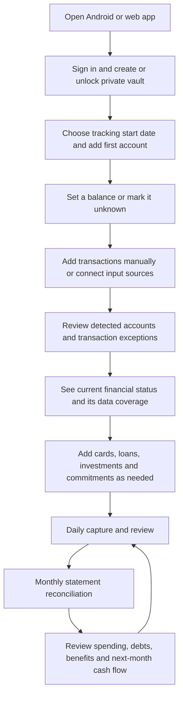

# Financial Management — User Journeys and Product Specification

Status: proposed product specification, based on the agreed requirements and supplied financial records. Story IDs remain stable as journeys are added; their grouping follows the user experience rather than numerical order.

This document describes the financial application from the user's perspective, including inputs, screens, automation, review, implementation behavior, and acceptance criteria. It is the financial-management companion to [APPLICATION_PLAN.md](APPLICATION_PLAN.md). **NBR-compatible expenditure classification, supporting asset-acquisition records, and expenditure summaries are part of this release.** Taxpayer identity setup, tax-liability calculations, full return preparation, and filing remain outside this document. Spending must be captured in a form suitable for a later return from the beginning.

Reading order: [experience](#1-the-experience-we-are-building) → [screens](#2-navigation-and-daily-screens) → [onboarding](#3-onboarding-what-the-user-must-enter) → [product inputs](#4-product-forms-exact-information-to-collect) → [capture](#5-bringing-transactions-into-the-application) → [review](#6-reviewing-activity-and-keeping-accounts-accurate) → [products](#7-financial-products-and-commitments) → [charges and benefits](#8-charges-waivers-cashback-and-rewards) → [daily/monthly use](#9-daily-use-planning-and-the-monthly-journey) → [sync and recovery](#10-continuing-on-another-device-and-protecting-my-work) → [walkthrough](#11-a-concrete-first-month-walkthrough) → [implementation](#12-implementation-structure-and-delivery-order) → [acceptance](#13-acceptance-and-verification-checklist) → [remaining configuration](#14-defaults-and-information-still-needed-for-implementation).

## 1. The experience we are building

The user should be able to say: **“I know my current financial status: how much money I have available, what I own and owe, what is paid or overdue, and what needs my attention. I can see how I reached this position, how current the information is, and what is coming next.”**

The application combines transactions, supporting evidence, financial products, and future commitments. Users work with familiar actions such as buying something, transferring money, paying a bill, receiving salary, lending money, or recording an investment. Bookkeeping entries and synchronization machinery stay behind those actions.

### Current financial status is the first answer

The primary experience is a current financial snapshot, supported by transaction history and followed by future planning. Collecting activity is how the app establishes that position; a transaction feed alone is not the product's main answer.

| Question the user needs answered now | What the application shows |
|---|---|
| How much money do I have access to? | Booked/tracked cash, bank, MFS, and prepaid balances, with a separate available-funds figure only where holds and restrictions are known; unknown availability is explicit |
| What is my current debt? | Card debt, loan principal, informal borrowing, and confirmed unpaid incurred bills, with borrowing and bill payables distinguished and counted once |
| Where do my assets and money stand? | Investments, deposits, retained assets, and money lent, showing cost/outstanding amounts and dated valuations separately |
| What is paid, part-paid, unpaid, or overdue? | Status and remaining amount for bills, EMIs, card statements, lending repayments, and investment receipts where due dates exist |
| What activity is still pending? | Pending authorizations, transfers awaiting a counterpart, unconfirmed receipts, and unmatched charges; these do not masquerade as settled transactions |
| Where am I this month? | Actual income received, spending by NBR head, principal repaid, asset additions, and remaining category budgets for the current reporting period |
| What needs action now? | Overdue obligations, negative tracked balances, unresolved monetary differences, failed source checks, and unclaimed benefits whose deadlines are due |
| Can I trust these figures as current? | Included accounts, unknown positions, latest captured activity, source coverage, last reconciliation, and unresolved differences |

Current cash, total assets, total liabilities, and net position are separate views. Net position is assets minus liabilities on a stated and consistent valuation basis; incomplete assets/debts or mixed/stale valuations make it a partial estimate. Future salary, expected investment profit, uncredited cashback, and unused card limits are not current money owned. "Available to spend after commitments" belongs to a separately labeled forecast with a horizon and assumptions, not the actual cash-balance total.

The snapshot must say "Based on records through …" rather than imply a live bank connection. A recent synchronization time does not prove recent bank evidence. Each important total opens the accounts, records, and dates behind it. Unknown information is shown explicitly instead of replaced with zero or a misleading complete total.

### Current-status calculation contract

The initial release uses BDT-denominated ledger accounts and exact poisha amounts. Foreign purchase/receipt currency is retained as source metadata, with the actual bank-booked BDT amount controlling postings; see the currency contract below. Do not convert or add foreign values without an evidenced BDT settlement. The default net-position view uses recorded cost/outstanding basis; optional supplied valuations are a separate dated estimate, not mixed silently into cost totals.

| Metric | Definition and unknown-data behavior |
|---|---|
| Booked account balance | Confirmed opening position plus posted inflows minus posted outflows at the selected cutoff; missing anchor means unknown balance, though activity totals are still available |
| Liquid booked funds | Sum of known owned cash/bank/MFS/prepaid balances eligible for this view; negative balances are shown explicitly, and debt reconciliation below prevents double counting an overdraft |
| Available funds estimate | Booked funds minus evidenced active holds/restrictions that have not already reduced that booked amount; if hold coverage is unknown, show booked funds and "Availability not confirmed" rather than claim an available balance |
| Active hold | An amount, currency, account, recorded date, evidence, and Active/Released/Settled state; expiry requires an evidenced release or user confirmation, not an assumed timer |
| Card debt | Posted purchase/cash-loan principal, interest and fees, minus credited settlements/refunds; include installment principal once. Credit balances are shown separately as receivable credit, not negative spending |
| Other debt | Outstanding loan/informal principal plus separately posted unpaid interest/fees not already in that liability; exclude future unaccrued interest. Show principal and unpaid charges separately |
| Unpaid incurred bills | Confirmed costs of goods/services already received, less valid settlements/adjustments, held as bill payables and included in total liabilities/net position once. Estimated future bills are commitments; amounts already in card/loan debt are not added again. Unknown settlement/recognition coverage makes the affected position partial |
| Overdraft | A negative asset balance is reclassified once as debt for gross asset/liability/net-position reporting; the account can still display its signed balance. It must not also be subtracted a second time |
| Noncash assets | Outstanding invested principal, deposits, receivables and retained-asset cost at the cutoff, adjusted for documented returns, disposals and write-offs; missing cost or unsupported valuation stays unknown |
| Net position | Assets less liabilities using the selected common basis and cutoff, with explicit exclusions, unknown components and stale evidence; a partial subtotal is labeled partial |
| Remaining obligation | Amount currently due minus valid payment allocations/credits for that occurrence; future installments and the current installment are not added on top of the same outstanding principal |
| Period activity | Income, financial consumption, principal movements, asset additions and NBR report allocations are separate measures, not interchangeable totals |
| Unresolved treatment | A confirmed owned-account movement with known amount/direction/date but unknown purpose updates that account against an explicit suspense position. Suspense is neither confirmed income/expense nor an assumed asset/debt; exclude it from verified classification totals and mark net position/reporting partial |
| Money in transit | A confirmed movement between identified owned endpoints that has not yet been credited at the destination. Track the evidenced departure and arrival separately; it is a transfer position, not accessible cash or a second expense |

Enter holds/restrictions from Account → Balance details → Add hold, or confirm a detected hold from an alert. When a hold settles, link it to the posted movement and remove its reservation effect in the same operation. For example, Tk 10,000 booked with a confirmed Tk 2,000 hold gives Tk 8,000 estimated available; after that purchase posts, Tk 8,000 booked and no active hold still gives Tk 8,000, not Tk 6,000. Available credit and forecast income never enter available-funds assets.

Trusted devices show their local working snapshot, clearly labeling unsynced changes. After a detected financial conflict, the last server-committed whole operation is the shared reporting baseline and the local alternative is shown separately, not summed into it. Totals affected by unresolved conflicts are provisional; formal expenditure summaries cannot be marked complete until those conflicts are resolved. See US-30 for conflict actions.

### Initial currency support and foreign purchases

BDT is the initial accounting currency, not just the default display currency. New bank/MFS/cash/card/loan/investment positions must be BDT-denominated in this release; a non-BDT account or genuinely cross-currency transfer is shown as unsupported for ledger posting, with its source retained for reference/manual BDT treatment when an actual BDT settlement exists. Do not create a fake BDT account or discard the source. Full foreign-currency accounts, exchange-rate feeds, foreign-balance revaluation and cross-currency account transfers require a later specification and are not implied by a foreign purchase on a BDT card.

For a foreign merchant transaction, record original amount/currency, transaction date, bank posting date, BDT settlement amount, and identifiable separate conversion/service fees. Retain exchange-rate evidence if supplied; an implied rate is informational and never replaces the settled amount. If only a foreign authorization/invoice is available, retain a pending candidate with no invented BDT posting. If the BDT movement is known but the original foreign details are missing, post the evidenced BDT amount, retain the incomplete metadata, and do not invent a rate. A combined charge can post in full while its fee/component split awaits review. A fee already included in the booked amount must not be added again.

Refunds post the actual BDT credit when received. When the original purchase/refunded component is identifiable, reverse its original booked BDT cost (proportionally for an evidenced partial refund), then record any difference from the actual credit as a separate realized exchange/settlement difference. Do not alter the historical conversion or assume original fees were refunded. For example, a USD 10 purchase booked at Tk 1,230 followed by a full refund credited at Tk 1,240 produces one Tk 1,240 credit, Tk 1,230 reversal of original cost, and Tk 10 realized gain. A Tk 1,200 refund instead gives Tk 30 realized loss. Unknown refund scope or embedded fee treatment remains a component review, not a reason to hide the actual bank credit. NBR allocation of differences and fees uses the verified mapping register or stays unresolved.

### End-to-end journey

### What counts as a successful first session

The user has one account, an explicit balance status, at least one recorded or reviewed transaction, and a first current-status snapshot. They can tell what is known, what is missing, and which action will improve the picture. They do not have to enter all accounts, connect their inbox, upload years of history, or configure every financial product before using the app.

The overview is useful with partial information but must clearly identify missing balances, incomplete history, and unresolved transactions.

### Shared product defaults

| Decision | Initial behavior |
|---|---|
| Users | One owner and one personal financial space; this is not a public multi-user release |
| Platforms | Android and responsive web with the same financial features |
| Currency and dates | BDT-only ledger in the initial release, foreign-transaction metadata with evidenced BDT settlement, and Asia/Dhaka by default |
| Storage | Encrypted Firebase synchronization and optional encrypted Drive backups |
| Credential storage | Google Password Manager or Apple Passwords as the user's primary choice; both can serve the same application profile |
| Expense categories | Official NBR expenditure heads with explicitly mapped detail categories; no invented official report heads |
| Processing | Financial parsing and calculations on unlocked devices |
| Email provider | Gmail initially; other providers are an extension, not silently assumed supported |
| Automation | Known unambiguous events are handled automatically; ambiguous events need review |
| Inputs | Manual entries, Android SMS, SMS XML files, emails, PDF statements, receipt images, and supported workbook migration |
| Actions | Tracking and planning; the app does not execute payments or contact banks or borrowers |
| Terminology | Separate actual money movements, scheduled commitments, and hypothetical plans |

## 2. Navigation and daily screens

| Screen | What the user sees and does |
|---|---|
| Home | Current financial status first: booked balances and evidenced availability, assets/debts, paid/unpaid/overdue commitments, month-to-date position, pending activity, data coverage, and action items; history and forecasts are separate sections |
| Activity | Searchable transactions; add, assign NBR expenditure heads, split, link, correct, or inspect evidence |
| Accounts | Banks, MFS, cash, prepaid accounts, cards, balances, and statement history |
| Commitments | Loans, EMIs, bills, subscriptions, borrowing, and their due dates |
| Assets & Lending | Investments, deposits, savings certificates, retained assets such as electronics/furniture, money lent, and expected receipts |
| Planning | Budgets, cash-flow calendar, savings targets, purchase scenarios, and an NBR expenditure summary |
| Inbox & Review | Imports, source connections, unresolved extraction, duplicates, mismatches, and category questions |
| Settings | Categories and rules, security, devices, backup, exports, and source permissions |

Android uses a compact navigation bar for Home, Activity, Accounts, and More, with a persistent Add action. Web uses a sidebar, wide tables, bulk review, and a side-by-side evidence panel. Every financial action remains available on both; direct phone SMS access is Android-specific.

Home and each account show a visible "as of" time. Last source check, last successful reconciliation, and synchronization status are separate facts.

## 3. Onboarding: what the user must enter

### Short setup versus progressive setup

Required setup is limited to securing the financial space, confirming preferences, and adding the first account. Income, products, balances, historical documents, and automation can be completed progressively. The app seeds the verified NBR expenditure catalog; the user confirms reporting-period dates before generating a complete NBR summary. No NID, TIN, employer certificate, bank password, card PIN, CVV, or full card number is required.

### Onboarding sequence

| Step | User input | Required now? | Result |
|---|---|---|---|
| 1. Enter | Google sign-in; choose new financial space or restore existing data | Yes | Identify the owner and prevent accidental creation of a second vault |
| 2. Secure | Choose Google Password Manager or Apple Passwords; save a vault passphrase or supported vault-unlock passkey; test retrieval/unlock; save and confirm recovery key | Yes for a new vault; an enrolled passphrase, independent recovery key, or trusted unlocked device is needed where passkey decryption is unsupported | Enable encrypted records, manager-assisted access, and recovery |
| 3. Preferences | Confirm BDT, timezone, and preferred monthly budget start day; review the seeded NBR expenditure catalog and reporting-period dates | Currency/timezone yes; budget day defaults to 1; NBR period confirmation required before a complete expenditure summary | Set financial defaults and source-backed expenditure reporting |
| 4. Starting point | Track from today or choose a historical start date | Yes | Define which activity contributes to tracked balances |
| 5. First account | Account type, institution when applicable, nickname, currency, and opening-balance status | Yes | Create the first place to record money or debt |
| 6. Balance | Known opening amount and boundary date, verified statement opening balance, or "I don't know yet" | Explicit choice yes; amount can wait | Avoid representing missing information as zero |
| 7. First activity | Add one transaction, upload a file, connect SMS/email, or skip | Optional | Begin recording activity |
| 8. Other finances | Select relevant cards, loans, lending, deposits, investments, and bills | Optional | Build a tailored setup checklist |
| 9. Summary | Review accounts and balances, source access, and outstanding setup tasks | Yes | Open Home with a clear picture of completeness |

"Track from today" means start-of-day at the selected local date. Explain this beside the balance field: **“Balance immediately before transactions on this date.”** If the user only knows the balance right now, offer the current-balance checkpoint workflow instead of silently using it as the opening balance.

### US-01 — Create and secure my financial space

**Story:** As a new user, I want to create a private financial space so I can use the same records on my phone and browser.

**Experience:** Welcome → Continue with Google → Create private space → Choose Google Password Manager or Apple Passwords → Save vault passphrase or a supported vault-unlock passkey → Test saved access → Save and confirm recovery key. Display the app's Google account email beside the credential label. For Google Password Manager, guide the user to save under that same Google account. For Apple Passwords, explain that storage is in their Apple account/iCloud while the app profile remains the same Google-signed-in profile. Offer biometric unlock on Android after setup. The user may add the other manager later.

**Implementation:** Google authentication establishes identity; device-side encryption protects financial contents. Integrate Android Credential Manager and web password autofill/WebAuthn with the app's stable domain. Passphrase forms support browser/password-manager saving without submitting the secret to the application backend. Bind app-specific passkey public credentials to the existing owner UID after authenticated enrollment. A normal passkey authenticates; vault decryption additionally requires a supported client-side PRF/key-wrapping flow. Feature-test that capability and offer the saved-passphrase/recovery path when unavailable. Store a separately wrapped vault key per supported unlock credential; never derive a decryption key from a passkey signature or public key. Persist setup progress as encrypted drafts. If an existing vault is found, offer unlock or restore rather than another blank space.

**Acceptance:** Google Password Manager and Apple Passwords each support a tested primary save/retrieve path on supported platforms. A second device opens the same space after sign-in and unlocking. An unsupported PRF response cannot lock the user out or claim a passkey can decrypt the vault. Recovery works without the original phone. Canceling a manager prompt keeps setup resumable; manual unlock remains available. Dismissing an optional biometric prompt does not interrupt setup. The application backend never receives plaintext passphrases, recovery keys, private passkey material, PRF outputs, or unwrapped vault keys.

**Platform boundary:** The password manager and user control the provider and storage account. The app can label credentials with its Google profile, guide account selection, and test retrieval; it cannot silently force or independently verify the manager's Google account. Record any same-account confirmation as user-confirmed, not API-verified. Apple Passwords cannot store an iCloud credential inside a Google account. Allowing either manager as primary is the user's selected resolution of that distinction. Password-manager cloud synchronization is performed by the chosen provider with user consent, separate from encrypted app-data synchronization.

Show only provider paths supported on the current device/browser, with instructions for other devices; do not promise a native Apple Passwords picker on Android. A passkey-only vault may have no passphrase wrapper: on an unsupported-PRF device, require the tested recovery key or an already unlocked device, then offer enrollment of a saved passphrase or another compatible credential. Offer a passphrase fallback only when one was actually enrolled. Test both manager-assisted retrieval and cross-device decryption, not just successful passkey registration.

### US-02 — Choose how far back to track

**Story:** As a new user, I want to choose a manageable starting point without reconstructing my whole financial life.

**Experience:** Choose "Start today" or "Bring in earlier activity." Historical users select a date and see the required opening balances. The app explains that older documents may still be stored as reference evidence.

**Implementation:** Store a default tracking boundary, with account-specific boundaries when an account has different evidence coverage. Documents before that boundary remain reference-only unless the user explicitly extends the account's history. Extending history previews the replacement opening position and affected reports before confirmation.

**Acceptance:** Older imported transactions cannot change current balances twice. A missing opening amount remains unknown. Changing the boundary cannot silently rewrite a reconciled period.

### US-03 — Add my first account and establish its balance

**Story:** As a user, I want to add the account I use most and know whether its displayed balance is reliable.

**Experience:** Choose Bank/MFS/Cash/Prepaid → institution if applicable → nickname → optional masked identifier → balance setup. Offer "Opening balance at start," "Use statement," "I know today's balance," and "Unknown." Unknown accounts can still receive transactions and show activity totals.

**Implementation:** Record known opening balances as opening entries, not income. A current balance is a dated checkpoint. It becomes an anchor only after movements between the tracking boundary and checkpoint are complete or an explicit opening adjustment is reviewed. Do not derive an opening balance from an incomplete SMS history.

**Acceptance:** A Tk 20,000 opening balance plus a Tk 1,000 purchase produces Tk 19,000, with no Tk 20,000 income. Unknown balances do not appear as zero in totals. A mismatch offers review or an explicit adjustment with a reason, never an invisible correction.

### US-04 — Finish quickly and resume setup later

**Story:** As a user, I want to start using the application before entering every product and historical document.

**Experience:** Home opens with a checklist such as "Add your other accounts," "Confirm one balance," and "Import transactions." Tasks are relevant to selected products and can be postponed. Existing balances and entries stay usable.

**Implementation:** Save each completed step independently. Setup status is separate from account verification and transaction reconciliation. Ask for source and notification permissions only when the user activates those features.

**Acceptance:** Denying SMS/email access leaves manual entry and document import available. Closing the app resumes at the saved step. Completing onboarding does not label incomplete finances as verified.

## 4. Product forms: exact information to collect

These forms appear when the user adds the relevant product, not as one long onboarding questionnaire. A source may prefill fields, but the user confirms ownership, identity, and starting balances before activation.

Currency fields below are fixed to BDT for the initial release. Foreign original amounts belong to transaction evidence metadata, not a second foreign-denominated ledger position. Imports that require unsupported foreign accounts remain reference-only with an explicit explanation.

| Product | Minimum fields to activate | Optional or later | What the app derives |
|---|---|---|---|
| Bank/MFS/prepaid account | Type, institution, nickname, currency, tracking boundary, balance known/unknown | Masked identifier, full account number if needed for documents, branch, opening date | Balance from confirmed opening plus posted movements |
| Cash wallet | Nickname, currency, boundary, balance known/unknown | Purpose or location | Tracked cash balance and movements |
| Debit card | Nickname, issuing institution, linked account, last four digits if available | Network, expiry month/year, product fees | Activity through the linked account; no second cash balance |
| Credit card | Institution, product/nickname, currency, tracking boundary, opening debt known/unknown | Last four digits, limit, statement closing day, due-date rule or next explicit due date, annual-fee date, statement, minimum due, benefits policy | Purchases and payments immediately; outstanding liability when anchored; statement due and available credit when their inputs are known |
| New institutional loan | Lender, disbursement date, principal, receiving account, repayment terms, first due date | Interest method/rate, upfront fees, agreement, recurring debit account | Schedule, interest/principal allocation, projected payoff and total cost |
| Existing loan | Lender, balance date, outstanding principal known/unknown | Next due date, known installment or lender schedule, original principal/date, past payments, rate, fees, agreement | Remaining schedule where inputs suffice; otherwise position tracking and amount/date reminders when entered |
| Card installment plan | Parent card, underlying purchase/loan link, financed principal, start date, installment count and amount or complete rate terms | Conversion fee, lender schedule, first statement date | Remaining principal and installment commitments inside card debt |
| Money lent or borrowed | Direction, counterparty label, date, original amount or current outstanding, currency, funding account or opening-position choice | Expected repayment date, interest agreement, proof, notes | Receivable/payable balance, repayments, overdue status when due date exists |
| FDR | Institution, principal/current position, start date, maturity date, funding link or opening-position choice | Rate, compounding/payout terms, withholding, renewal instruction, nominees, proof | Expected maturity/payouts when terms are known; actual receipts separately |
| DPS | Institution, installment amount, schedule, start date, maturity date, current accumulated principal or payment history | Rate, missed-payment terms, debit account, nominees, proof | Due installments, posted contributions, outstanding dues, expected maturity if calculable |
| Savings certificate | Type, issuer, face value/current position, issue date, maturity date, funding link or opening-position choice | Payout terms, joint holder, nominees, withholding, certificate proof | Principal position, payout reminders, expected and actual returns |
| Other investment | Organization/type, principal, investment date, funding link or opening-position choice | Expected return date/amount, distributions, fees, proof, valuation | Principal invested, actual returns, expected proceeds and supplied valuations separately |
| Retained personal asset | Description/type, acquisition or existing-position choice, acquisition/as-of date, cost known/unknown, ownership share, NBR asset treatment or pending review | Funding transaction, invoice/proof, serial/model, later valuation | Linked acquisition cost, dated holdings, refunds/disposals, and asset additions separately from lifestyle expenses |
| Recurring bill/subscription | Name, fixed or variable amount choice, frequency, next due date | Explicit estimate and its basis/date for a variable bill, category, paying account/card, end date, reminder preference | Due calendar; priced or visibly unpriced forecast commitments; no payment is assumed |
| Confirmed incurred bill, one-off or recurring | Payee, owner's bill amount, confirmed incurred date, paid/outstanding status known/unknown with its as-of date, new cost or existing-position choice | Bill issue date, service period, due date, occurrence link, prior payment/card links, category, evidence | One recognized cost and its unpaid payable where established; unknown settlement stays under review, and no bank payment is invented |
| Expected salary/income | Label, expected amount, frequency, expected date | Receiving account, employer/payer label | Forecast receipts and expected-versus-received comparison |
| Fee/benefit policy | Product link, policy type, effective period, required terms for evaluation | Official terms/document, claim instructions, notes | Progress and expected charge/benefit when terms are complete |

For an existing product, offer two explicit paths: **“Record its current position”** or **“Reconstruct from its original transaction.”** Never add a historical disbursement or purchase on top of a current opening position for the same principal.

If an account or card identifier is incomplete, keep matching tentative. The same last four digits can occur on different products. Institution, currency, product type, and user confirmation also matter.

## 5. Bringing transactions into the application

### Shared input and processing contract

| Stage | User-visible behavior | Implementation behavior |
|---|---|---|
| Capture | See source, account, date range, and progress | Create an import batch or source observation with stable identifiers |
| Extract | See detected facts beside the source | Parse into candidate events; preserve original wording and location |
| Resolve account | Confirm a detected account or pick an existing one | Never automatically create an active owned account from an alert |
| Match | See existing transaction links or duplicate questions | Check repeated imports and cross-source evidence before posting |
| Classify | See financial action and category suggestion | Apply established rules; retain confidence, provenance, and overrides |
| Post/review | See recorded events separately from items needing attention | Post complete unambiguous actual events; stage uncertain amounts, ownership, or status |
| Reconcile | See statement coverage and balance checks | Compare posted entries with authoritative period evidence |

A posted transaction may still need a category or financial purpose. If the affected owned account, amount, direction, date and completed outcome are established, record that observed leg immediately, using an unresolved suspense treatment if necessary. Here "ownership" means identifying the affected account as the user's account, not knowing the recipient's ownership or purpose. Unknown recipient, uncertain expense-versus-lending purpose, or missing repayment components must not hide a confirmed account debit. Uncertain affected account, amount, direction or completed outcome prevents posting that leg. These are different problems and must have different review actions.

Example: a statement proves a Tk 5,000 debit from an account with Tk 10,000 booked funds, but its purpose is unclear. Show Tk 5,000 booked funds and a Tk 5,000 "Explain this movement" task; do not invent an expense, receivable or internal transfer. Resolving it reclassifies the suspense side of the existing event into the evidenced expense/asset/liability/transfer treatment without another bank movement. Expenditure summaries and affected net-position totals stay partial until resolved. If later identified as an owned transfer, link its actual arrival using US-14; if confirmed failed/reversed, use a separate evidenced reversal. Resolving or reversing it revalidates source links, allocations, reconciliation and report revisions.

Financial recognition and cash settlement are separate events. A confirmed incurred bill can record an expense and payable under US-23 without a bank movement. Match existing purchases/payments before recognizing its cost; a later invoice is evidence for the same cost, not another expense. This distinction applies to manual entry and every import source.

### Review priority and visible states

The review screen puts monetary problems first: unknown account or amount, conflicting events, missing statement lines, and unresolved transfers. Category questions follow. A task states the problem, affected amount/account when known, supporting evidence, and a concrete next action. "Ignore" requires an explicit reason and leaves an audit record; ignoring a monetary discrepancy does not make reconciliation pass.

| Status dimension | Example shown to the user | Meaning |
|---|---|---|
| Source processing | Captured / Couldn't read / Partially read | Whether the source was extracted successfully |
| Transaction outcome | Pending / Completed / Failed / Reversed | Whether the economic movement occurred |
| Posting | Needs confirmation / Recorded | Whether the movement affects actual balances |
| Category review | Uncategorized / Suggested / Confirmed | Whether the spending explanation is resolved |
| Reconciliation | Not checked / Matched / Difference found | Agreement with specific statement evidence |
| Commitment | Upcoming / Part-paid / Paid / Overdue / Skipped because not due | Fulfillment of an obligation or reasoned removal of an expectation; skipping cannot discharge money owed |
| Source coverage | Last checked / Missing dates / Complete for this statement | Scope of evidence available; not a promise that every real-world event is captured |

Each screen shows only the relevant status dimensions in plain language. An uncategorized, recorded, completed purchase can still be statement-matched. A successfully parsed reminder can still have no payment recorded.

### US-05 — Record a transaction manually

**Story:** As a user, I want to record cash or missing activity immediately.

**Experience:** Add → choose Expense, Income, Bill, Transfer, Repayment, Lending, or Investment → enter amount and date/time → choose an account for a money movement or the bill details from US-23 → category or purpose → Save. Default date to now and offer the last-used account where appropriate. Counterparty, notes, and evidence are optional except where the focused form requires them. Bill/loan/investment actions open their focused forms; recording an unpaid bill does not require a fictitious paying account.

**Implementation:** Validate positive amounts, currency, account ownership, and splits. Create the necessary balanced ledger postings as one operation. Users never need to enter bookkeeping debits/credits.

For an unexplained movement, the focused action is "Record movement—purpose unknown" with owned account, BDT amount, direction, date and evidence. Foreign merchant details are optional additional fields under the currency contract; a foreign amount alone cannot populate the required BDT field without a confirmed settlement.

**Acceptance:** Saving offline works. A double tap creates one record. Income is distinct from loan proceeds, refunds, and repayment of money lent. A later imported alert can attach to the manual record.

**Net receipts and deductions:** Add → Income/Return received → record net receipt and, when available, gross amount plus separately identified deductions. Accept payslip, interest/profit certificate, or manual deduction evidence with purpose, date, and payer. Reconcile gross minus deductions to the single bank receipt. A Tk 50,000 gross salary with Tk 1,000 withholding and Tk 49,000 bank credit produces one Tk 49,000 bank movement plus a distinct evidenced deduction; importing the bank alert later must not record the salary twice. Missing gross/deduction evidence stays a reporting review issue. Withholding is not inferred from the gap unless the deduction purpose is established, and VAT is not assumed to be withholding.

### US-06 — Import historical SMS messages

**Story:** As a user, I want my existing bank and payment alerts to become a usable activity history.

**Experience:** Inbox & Review → Import → SMS backup XML → choose date range and financial senders → preview detected accounts and event counts → confirm import. Summary separates recorded events, linked duplicates, ignored messages, and issues. Nonfinancial messages are excluded from the saved financial evidence by default.

**Implementation:** Parse safely with external entities disabled. Preserve sender, message timestamp, source transaction reference, and parser version. Scope duplicate identity to the source message and cross-check economic events; identical text alone is not proof of duplication.

**Acceptance:** Reimporting a backup creates no extra movements. Two legitimate same-amount payments stay distinct. Unparsed messages are visible and can be converted manually, reprocessed, or marked irrelevant. OTPs and promotional messages do not become transactions.

### US-07 — Capture new financial SMS on Android

**Story:** As an Android user, I want new financial alerts captured without entering every transaction myself.

**Experience:** Enable SMS capture in Sources → read the permission explanation → grant permission → select relevant senders/accounts → preview a sample. Home reports the last successful check and any pending review. Revocation produces a reconnect prompt rather than losing existing records.

**Implementation:** Use Android-specific SMS access behind an input adapter. While locked, defer private processing and retain message references for catch-up. Re-scan from the saved checkpoint after unlock or interruption. Preserve XML import as the fallback. Direct SMS capture on web is not offered; the web sees encrypted records synchronized from Android.

**Acceptance:** Capture never assumes all bank movements generate SMS. Failed/authorization alerts cannot become completed payments automatically. A permission denial leaves the rest of the app usable. Full personal inbox content is not sent to the backend.

### US-08 — Connect one or more Gmail inboxes

**Story:** As a user, I want financial emails and attached statements collected alongside SMS records.

**Experience:** Sources → Add Gmail → choose mailbox and grant read access → choose financial senders/labels and date range → preview findings → map accounts → import. Repeat for another mailbox. Each mailbox has its own last-check time, pause, reconnect, and disconnect actions.

**Implementation:** Use separate read-only Gmail authorization, not the Google sign-in permission. Application sender filters do not narrow Google's mailbox-wide read permission; explain that at consent. Read and parse selected bodies and attachments locally, encrypt retained evidence, and keep tokens out of synchronized financial records. Check periodically while open and unlocked; catch up later when closed or locked. Use mailbox/message identity and incremental history with bounded rescans.

**Acceptance:** The app does not send, modify, mark read, or delete emails. A statement attachment can enter the statement pipeline. An order confirmation creates a suggested purchase/commitment, not an assumed completed debit. One email can contain several events. Disconnect stops future reads and retains previously imported evidence unless the user removes it explicitly.

### US-09 — Import an email or receipt without mailbox access

**Story:** As a user, I want to use documents from any provider without connecting an inbox.

**Experience:** Import an `.eml` file, PDF, or receipt image; alternatively paste a financial message. Preview extracted fields and select the account. Unsupported inputs remain viewable as evidence and can support manual entries.

**Implementation:** Route supported MIME parts and attachments through the same extraction pipeline. Sanitize HTML, block remote images/scripts, limit file sizes, and do not execute attachment content. Receipt extraction is a suggestion; payment method and completion still need confirmation.

**Acceptance:** An unknown merchant format cannot silently disappear. Parser failure preserves the uploaded evidence. Gmail authorization is not required for manual email/attachment import.

### US-10 — Import bank or card statements

**Story:** As a user, I want to use statements to fill missing activity and verify my balances.

**Experience:** Upload PDF → confirm detected account and actual statement period → unlock a password-protected PDF locally if needed → view lines and extraction issues → review matches → apply. Show file coverage, opening/closing balances, and lines needing attention.

**Implementation:** Use bank-specific parsers with a generic extraction/manual path. Store transaction and posting dates, debit/credit direction, running balances, source page/line, and covered dates. Text extraction precedes local OCR. Scanned or partial results require review. Keep PDF passwords in memory for the current operation only.

**Acceptance:** Duplicate files are recognized. Overlapping statements do not duplicate movements. Unknown formats can be mapped manually. Date-only lines are not assigned fabricated times. Incomplete extraction cannot mark the account reconciled.

### US-11 — Bring in my savings workbook

**Story:** As a user moving from spreadsheets, I want to reuse existing loans, investments, and plans without importing incorrect totals as transactions.

**Experience:** Import workbook → select sheet → identify whether it contains balances, products, transactions, or plans → preview column mapping and warnings → confirm records individually or in reviewed batches. Show conflicting loan records and linked proof files separately.

**Implementation:** Start with an adapter for the supplied savings workbook. Read saved values and formulas as source evidence; do not execute arbitrary workbook code. Recognize repeated loan/EMI records, summaries, expected returns, and dated positions. Use the same product forms and validation as manual setup. Unrecognized layouts require manual mapping or entry; do not promise generic spreadsheet understanding.

**Acceptance:** Monthly spending totals do not become invented transaction histories. Expected investment proceeds do not become received income. Duplicate workbook copies and repeated loan rows produce review links. Existing workbook calculation inconsistencies are shown, not imported as verified truth.

### US-12 — Recognize one event across several sources

**Story:** As a user, I want an SMS, email, receipt, and statement about the same payment to support one transaction.

**Experience:** Transaction detail shows "Evidence: SMS, email, statement." A potential duplicate appears with both candidates and actions: Link to existing, Keep separate, or Ignore source item. User corrections remain visible when stronger evidence arrives.

**Implementation:** Match reference, account/card, currency, amount, direction, relevant date window, and merchant. Auto-link only a unique strong match. Preserve ambiguous repeated purchases. Statement corrections create revisions while retaining earlier observations and user categorization.

**Acceptance:** A purchase recorded manually and imported three times changes the balance once. Refunds, authorizations, installment billing, and settlement payments cannot be merged merely because their amounts match. A mistaken link can be undone and its effects recalculated.

#### Independent imports on different devices

Exact source identity belongs to the vault, not the importing device or retry attempt. Use a stable keyed source fingerprint, derived locally with a separate per-vault deduplication secret retained across encryption-key rotations. The server receives opaque fingerprints, not SMS/email contents or transaction facts. Register each source claim and its event linkage atomically with the financial mutation.

- Gmail identity is mailbox plus provider message/attachment/part identity. A message with several events retains distinct event locations.
- A file identity is its content hash; individual source items retain stable page/row/occurrence locations. Parser version alone never creates a new source item; reparsing uses a reviewed revision when extraction boundaries change.
- SMS sources preserve provider identity where available; exported copies use normalized source facts plus preserved occurrence identity. Identical amount/text alone is never a unique economic-event key. Ambiguous occurrence matching remains reviewable.
- On reconnect, download committed claims and candidate matches before submitting the outbox. Two devices importing the same identified source cannot both commit another movement for it. Reuse the committed event if extracted facts agree; stage a conflict if they disagree.
- Different evidence for the same event, such as an offline SMS import on Android and email import on web, still needs cross-source matching after decryption. Quarantine a strong competing local candidate before commit; ask Link/Keep separate when uncertain. Do not invent a universal uniqueness rule from amount and date.

Prevent check-then-insert races with a vault matching revision. Read a consistent decrypted set of match-relevant records through revision R, propose the match/new event locally, and atomically check R, apply source claims plus the complete financial mutation, and advance the revision. A competing commit makes R stale: commit nothing, fetch the delta, and rerun matching before retrying. New manual events and edits/deletions/link changes that affect matching advance this revision too. Thus two devices cannot both check an empty baseline and insert the SMS and email as unrelated events without the second being re-evaluated. Revision coordination carries no financial plaintext. An unresolved cross-source match remains a review proposal, not an extra committed movement.

Offline counts are local working results until reconciliation with shared source claims. The losing duplicate candidate retains evidence and audit history but makes no extra shared posting. A deleted source-linked event retains its claim/tombstone; reimport offers explicit recovery/review rather than resurrecting it. Acceptance includes simultaneous same-file imports, independent SMS/email imports, repeated same-amount legitimate purchases, reparse, and key rotation.

## 6. Reviewing activity and keeping accounts accurate

### US-13 — Categorize my spending for NBR-compatible reporting

**Story:** As a user, I want each expense recorded under the applicable NBR expenditure head so my daily financial records can supply the spending part of a tax return.

**Experience:** Activity displays merchant, account, amount, date, official expenditure head or other financial treatment, optional detail category, and review status. The selector starts with NBR heads; examples such as rent and groceries appear beneath their mapped head. Open an item to correct its head, split the amount, add tags, or record an asset purchase. After a correction, optionally choose "Use this rule next time" with a preview of the mapping and affected records. The user does not build a reporting category system from scratch.

**Implementation:** Financial action comes before report mapping: a transfer, debt principal payment, investment, or asset acquisition cannot be forced into a lifestyle head merely because cash left an account. Seed the official form catalog with immutable source labels/item references and versioned, period-aware mapping rules. Detail categories are editable but must map explicitly to an official head or reviewed non-lifestyle treatment. Store allocation amount, form/catalog version, reporting period, evidence, and approval history. Split components total the original amount. New rules affect future events; historical application requires preview and confirmation and preserves prior report snapshots.

**Acceptance:** Rent, food, transport, and utilities roll up to their verified NBR heads. Mixed receipts can split across heads and asset acquisitions. User detail categories cannot create an invented official head. A user override is not replaced by later automation. Uncategorized outflows remain in cash-flow totals and in an unresolved amount; an NBR summary with unresolved treatment or an unverified applicable catalog is explicitly incomplete.

#### Official expenditure catalog and detail categories

The verified baseline is IT-10BB (2023), page 7 of the [official individual return form](https://nbr.gov.bd/uploads/form/Individual_Return_IT-11Ga%282023%292.pdf). The table below summarizes its nine heads; the application must load the official labels and item numbers from the verified catalog rather than treat these shorter descriptions as replacement form text. The form also has a separate asset line for furniture/electronics in IT-10B, page 9, item 8(i), and a separate non-lifestyle expenditure/loss line on page 8. This verifies form structure, not every year's treatment or a universal mapping for every purchase.

| Form item | Description of official head | Detail examples or review requirements |
|---|---|---|
| IT-10BB:1 | Household food, clothing, and essentials | Groceries and ordinary food purchases; mixed marketplace orders need line-item review |
| IT-10BB:2 | Housing | Personal rent; refundable rental deposits remain assets rather than rent expense |
| IT-10BB:3 | Personal transportation | Local fares and rides, distinguished from vacation travel |
| IT-10BB:4 | Utilities | Electricity, gas, water, telephone/mobile, and internet; separate them from rent when a bill combines both |
| IT-10BB:5 | Education | Confirm educational purpose; do not classify every software subscription as education |
| IT-10BB:6 | Travel and vacations | Personal travel/vacation costs separated from ordinary commuting |
| IT-10BB:7 | Festivals and special occasions | Purpose-specific spending; avoid repeating amounts already allocated elsewhere |
| IT-10BB:8 | Source deductions and relevant prior-return tax/surcharge payments | Preserve payment purpose and period; withholding and VAT are not interchangeable |
| IT-10BB:9 | Interest on personal borrowing | Allocate interest separately from principal and fees using supported evidence |

Friendly child labels are organizational details with required official mappings, not invented top-level NBR categories. Keep uncertain bank fees, gifts, subscriptions, repairs, and other exceptional items awaiting source-backed treatment when the correct destination is not established. Do not add a generic official "Other" head to make a report appear complete.

#### Electronics and other asset acquisitions

For a laptop, phone, furniture, or other retained asset, ask whether this is an acquisition, repair/service, disposal, or mixed purchase. An acquisition creates or updates a linked asset with cost, acquisition date, ownership, funding, and evidence, and carries the verified asset-report mapping. Cash/bank funding reduces the paying account when paid; card/loan funding increases the applicable liability without an immediate bank withdrawal. Repairs and other components receive their own reviewed expenditure mappings. Do not automatically report the whole acquisition as lifestyle consumption as well as an asset.

The financial register must therefore include retained nonfinancial assets such as electronics. One purchase supplies the movement, the asset record, and report traceability without duplicating cost. Usage, purpose, and applicable guidance may require review; merchant name alone cannot settle the treatment. Refunds and disposals update the linked asset and allocations with audit history.

Expose these records in Assets & Lending → Personal assets, with Add, Link purchase, Record refund/disposal, and View evidence actions. Adding an already owned asset records a dated opening position rather than a new cash purchase; unknown acquisition costs stay unknown. Show ownership share and preserve cost separately from any later user-supplied valuation. A disposal removes the relevant holding portion and links actual proceeds without rewriting the acquisition history.

#### Reporting and yearly changes

Provide an "NBR expenditure summary" in the financial release: choose explicit income-period dates → see totals per official head → inspect contributing allocations/evidence → resolve unclassified or conflicting treatment → export amounts and comments in the applicable form order. Display lifestyle totals, asset additions, other reviewed treatments, and unresolved outflows separately; reconcile these views to the financial ledger rather than force all debits into the lifestyle total.

Pin each summary to its catalog and mapping versions. Verify official sources and applicability for each supported period; a 2023-form baseline alone is not proof of current-year compliance. Propose changed mappings for approval, retain previous versions, and preserve exported snapshots. Ordinary transaction entry continues during a catalog gap, with unresolved reporting status; the app cannot label that period's summary complete. Period dates and categories must be configurable without hard-coding July–June. This expenditure subsystem ships with financial management; calculating tax liability and preparing the rest of the return remain later work.

Each mapping records its source-backed reporting-date basis; preserve purchase, posting, receipt, and deduction dates rather than choosing one globally. Cross-period card purchases, refunds, and corrections need the applicable mapping rule or manual review. Do not silently move previously exported allocations between periods. Before showing an expenditure summary as complete, check date coverage, account tracking boundaries, unresolved allocations, cash records, net-receipt deduction evidence, and asset links; ask the user to confirm completeness of manually maintained cash and other unconnected sources. Display that confirmation as user-attested, not independently verified.

US-23's incurred-date recognition defines financial consumption and bill payables, not the NBR reporting date. Retain the linked cost, bill, settlement and applicable mapping/date rule so recognition and later payment cannot create duplicate report allocations. A rule that needs payment evidence remains unresolved until that evidence exists; no financial recognition choice upgrades an unverified legal mapping.

#### Mapping coverage and release gate

Use a mapping register, not merchant guesses, to implement compatibility. Each rule records the official source URL/hash, section/page, official destination, applicable period, required purpose/evidence, reporting-date basis, allocation behavior, reviewer/approval, and Draft/Verified/Needs clarification/Retired status. An owner-confirmed transaction category is not automatically a verified legal rule. Personal notes and provisional choices are retained without upgrading source verification.

| Transaction family | Financial behavior and required mapping decision |
|---|---|
| Ordinary food/essentials, rent, commuting, utilities, education, personal travel and special occasions | Use the applicable verified head after purpose confirmation; split mixed payments and distinguish commuting from vacation and refundable deposits from rent |
| Withheld income/profit tax and prior-return payments | Preserve gross/net receipt reconciliation, deduction purpose, period and certificate/challan; apply verified head/date rules once, without another bank debit |
| Personal loan/card borrowing interest | Separate evidenced interest from principal and fees; verify the borrowing purpose and applicable personal-interest head rather than map the whole EMI |
| Bank/card charges, VAT, excise and processing fees | Record actual fee components financially; verify each component's NBR treatment separately. VAT is not source income tax. No automatic head assignment merely because the transaction is a bank debit |
| Software subscriptions and services | Capture purpose, beneficiary and invoice; map to education or another treatment only with applicable support, not the merchant name |
| Gifts, family support and shared bills | Ask purpose, beneficiary, payer and the user's share; distinguish gift, own expense, reimbursable advance and internal transfer. Use a verified non-lifestyle destination when applicable; do not force all support payments into special occasions |
| Electronics, furniture and repairs | Separate acquisition cost, ownership, service/repair components, refunds and disposals; verify asset versus expenditure treatment with evidence |
| Transfers, investments, principal repayment, returned principal and refundable deposits | Maintain their actual asset/liability movements and explicit non-lifestyle treatment; no invented consumption expense |

For a shared household cost, retain total bill, owner-paid amount, other person's contribution, any receivable/repayment and report comment. Post only evidenced movements in the owner's accounts. Do not count another person's payment as the owner's bank outflow or automatically treat a reimbursement as salary. A user-confirmed attribution must reconcile to the bill and retain a review trail.

The initial mapping-pack targets are the two supplied income periods (2024–2025 and 2025–2026) and current 2026–2027 activity, with explicit start/end dates confirmed from applicable sources. These are target coverage, not a declaration that every mapping has already been verified. The [official AY 2025–2026 guide](https://nbr.gov.bd/uploads/news-scroller/Nirdeshika_2025-26.pdf), printed pages 11–13, supplies expenditure/asset structure and family-contribution context alongside the form. The [official 2026–2027 guide](https://nbr.gov.bd/uploads/publications/Aykor_Nirdashikha_2026-2027_BG_Press_Modify_Copy.pdf) has been located, but its relevant mappings still require review; do not infer them from its title or unreadable extracted text. A later period remains a provisional pack until its sources and applicability are approved.

Before the financial release claims NBR-compatible reporting for any target period, every transaction family found in the supplied representative records must have either (a) a source-backed verified rule with an independently checked example, or (b) a named unresolved case visibly blocking that period's complete summary. The readiness checklist lists exact unresolved types and amounts; a generic "Other" category or owner acknowledgment cannot waive this gate. Daily recording and draft exports continue, clearly marked incomplete. This resolves the product behavior without inventing unsupported legal mappings: the outstanding work is evidence verification, not a hidden implementation choice.

### US-14 — Track transfers, cash withdrawals, and card payments

**Story:** As a user, I want moving my own money to avoid inflating income or expenses.

**Experience:** Choose Transfer, source and destination, amount, date, and optional fee. A withdrawal suggests the cash wallet as destination. A card repayment suggests the owned credit card. If the other side is missing, show "Transfer counterpart not confirmed" and offer linking when evidence arrives.

**Implementation:** Each observed leg creates a balanced operation atomically; the departure and arrival may be separate operations linked to one transfer. Record transfer fees separately. Confirmed departures between identified owned endpoints use a transfer-in-transit position until arrival is evidenced; unknown-purpose movements use the separate suspense treatment and do not assert ownership of the recipient. Source linking never fabricates the destination credit or changes its actual date.

**Acceptance:** Bank-to-bank transfers leave net wealth unchanged except fees, with evidenced transit shown separately from accessible funds. A cash withdrawal credits tracked cash when receipt is confirmed, not before. A card payment reduces the bank balance on its debit date and card debt on its confirmed credit date, without recording purchases again. Unconfirmed transit and suspense amounts remain separately visible with coverage/confidence limits; the app does not label them available cash.

#### Different departure and arrival dates

Transfer entry asks whether the user is recording initiation, a completed departure, a completed arrival, or both. Initiation alone is pending. Each confirmed side retains its own posting/value date, amount, reference and evidence; provide a single transfer detail showing Sent, In transit, Received, Part-received or Returned. An expectation of arrival is not evidence of arrival.

Example: Tk 3,000 leaves the bank on October 1 and reaches an owned card on October 3. On October 1, bank funds fall by Tk 3,000 and a Tk 3,000 transfer position appears; card debt and unpaid statement status do not change merely because money was sent. On October 3, close that transit amount and reduce card debt by Tk 3,000. The ledger remains balanced on each date. If the arrival is observed first, record the card credit against incoming-transfer clearing and retain the missing-source review task until departure is established. Do not invent a same-day bank debit.

Partial credits clear only the evidenced amount; keep the remainder in transit. Excess credits, incompatible references and amount differences require review; do not label a difference as a fee without evidence. A return to the source clears the transit position on its actual date rather than erasing history. Conflicting amounts or unknown destination retain a monetary review issue and partial consolidated status.

For a card credit, debt reduction and statement allocation are separate: reduce total debt for the confirmed credited amount even if its distribution among statement/minimum-due/installment/fee components is unknown. Hold that distribution in "Payment credited—allocation pending"; do not promise a statement is satisfied or interest avoided until evidence/verified product terms establish the allocation. Reallocating the credit never reduces debt a second time. Due reminders disclose sent/in-transit payments and allocation uncertainty rather than claiming the bank accepted them. Linking later statement evidence closes clearing/review against the same payment, not a new payment.

### US-15 — Handle refunds, failed payments, and corrections

**Story:** As a user, I want my history to reflect the actual outcome of each payment.

**Experience:** See Pending, Completed, Failed, or Reversed on each event. A refund can be linked to its original purchase and allocated to its categories. Corrections show before/after values, reason, and evidence. Duplicate removal asks which evidence should remain linked.

**Implementation:** Posting status, category-review status, and reconciliation status are independent. Pending commitments may affect forecasts but not posted balances. Refunds reduce the original spending where linked; they do not become salary. Preserve posted corrections through revisions or reversing entries. Removing a tracked transaction creates a tombstone and can reopen reconciliation.

**Acceptance:** Failed payments have no actual balance impact. Partial refunds and late reversals update spending and policy eligibility correctly. Undo does not create duplicate balances. Editing a reconciled transaction invalidates the affected reconciliation instead of leaving a stale verified badge.

### US-16 — Complete a monthly reconciliation

**Story:** As a user, I want to know whether the app agrees with my bank and card statements.

**Experience:** Account → Reconcile → choose statement → review matched, missing, conflicting, and unparsed lines → resolve each issue → check opening plus movements equals closing. Review duplicate category questions separately. Save a reconciled period when monetary checks pass.

**Implementation:** Use statement coverage and parsed totals, not upload success, as the reconciliation boundary. Imported bank/card evidence determines booked monetary facts; user explanations and corrected classifications remain attached. Keep unresolved disagreements in a task list. Balance adjustments require a reason and their own entry.

**Acceptance:** A missing bank fee can be created from a line. A same-value duplicate cannot be silently matched to the wrong purchase. Replacing a statement preserves the previous version. Reconciled means agreement with the specified statement and period, not that every possible cash expense has been captured.

## 7. Financial products and commitments

### US-17 — Manage a credit card as debt and a monthly bill

**Story:** As a user, I want to know what I owe, what must be paid next, and how much usable credit remains.

**Experience:** Card detail separates current total debt, latest statement balance, payments credited, minimum due, due date, installment commitments, and unbilled purchases. It shows fees, interest, benefits, and statement links. Record a payment or link an imported bank debit; review it against card-side credit evidence.

**Implementation:** Keep statement snapshots separate from the live card liability. Available credit requires a known limit and relevant holds; show it as an estimate when holds or data are incomplete. Statement payment allocation follows the verified product terms when available; otherwise ask the user to confirm application instead of assuming a lender allocation. Installment commitments remain part of card debt, not a second unrelated liability.

Apply US-14's separately dated payment-leg rules. A confirmed card credit changes total debt immediately; if statement allocation is unresolved, show that amount separately and keep affected due/paid status uncertain. Do not leave confirmed total debt overstated or mark an unconfirmed statement allocation as paid. A loan repayment with a known bank debit but unknown lender receipt or principal/interest split similarly updates the bank first, retaining transit or component review rather than inventing principal reduction.

**Acceptance:** Paying the minimum does not mark the statement paid in full. Paying a card is not spending. Due dates allow explicit statement overrides and month-end rules. A debit card displays its linked account balance without duplicating it in total assets.

Opening card debt, unpaid latest-statement amount, unbilled activity, and remaining installment principal are components/views of the same liability, not values to add together blindly. When billing details are missing, display "Due date not set" and omit due-based claims until the user supplies a statement or schedule.

### US-18 — Add and repay a loan or EMI plan

**Story:** As a user, I want one accurate record of a loan and a schedule that reflects what I actually paid.

**Experience:** Choose new loan or existing loan → enter relevant fields → preview schedule → confirm. Loan detail shows principal outstanding, upcoming installment, posted payments, fees, and expected payoff. Record payment, choose an existing bank/card movement, or split a combined payment across obligations.

**Implementation:** Support reducing-balance, flat-rate, and zero-interest/fee-based plans through explicit calculation strategies. Prefer a lender-provided schedule when verified. Link repayment allocations to one underlying movement; reconcile principal, interest, and fees without adding another debit. Existing debt starts from a dated position rather than a fictitious receipt of the original principal.

**Acceptance:** Zero-interest loans work. Partial payments leave remaining dues. The last installment absorbs rounding accurately. Early settlement includes explicit fees and evidence and replaces future projected dues without inventing payments. Insufficient terms produce a manual schedule, not a fabricated interest breakdown.

### US-19 — Convert a card purchase into installments

**Story:** As a user, I want an installment conversion tracked without seeing the original purchase charged again every month.

**Experience:** Open purchase → Convert to installments → enter conversion terms → preview affected card commitments → confirm. Alternatively link an imported plan notice to an existing purchase. Monthly statement installment lines attach to the plan.

**Implementation:** Preserve the original purchase's asset/expense split and official-report treatment. Conversion reallocates card liability to an installment subposition; it does not create a new expense, asset acquisition or duplicate debt. Card cash loans similarly link the disbursement to an installment liability. Fees/interest are separate actual charges when posted. A future installment is a commitment until billed or paid under the product's accounting.

**Acceptance:** A Tk 60,000 purchase converted into three Tk 20,000 installments remains Tk 60,000 principal, not Tk 120,000. Monthly billing and card settlement can coexist without double-counting. The card's total debt includes the remaining installment principal exactly once.

A Tk 60,000 laptop bought on a card creates one Tk 60,000 asset and Tk 60,000 card debt, with no bank movement at purchase. Converting it to three installments changes the debt schedule only. Paying a Tk 20,000 installment through the card settlement reduces bank funds and card debt once, leaves the acquisition cost unchanged, and does not create another Tk 20,000 lifestyle expense. Mixed purchases retain all original allocations.

### US-20 — Track money lent and borrowed

**Story:** As a user, I want to know who owes me, whom I owe, and how much has been repaid.

**Experience:** Add lending/borrowing → choose counterparty and direction → record advance or existing outstanding → optionally set due date and attach proof. Counterparty detail lists advances, partial repayments, interest, and balance. Link a later transfer or cash receipt to the outstanding item.

**Implementation:** Keep a receivable or payable with each advance and repayment allocation. Principal repayments are not income/expense. Interest is recorded separately. Unknown due dates are valid and do not imply overdue status. No messages or payment requests are sent to counterparties by the app.

**Acceptance:** Repeated advances can have separate terms while aggregating by counterparty. Partial repayments reduce outstanding amounts. Overpayments require review or allocation to another advance. Write-offs require an explicit amount, date, and reason and remain in history.

### US-21 — Track DPS, FDR, and savings certificates

**Story:** As a user, I want to track contributions, payouts, maturity, and renewal without confusing locked savings with spending money.

**Experience:** Add product → confirm current position or original funding → enter schedule/terms → review expected outcomes. Product detail separates principal accumulated, actual interest/profit received, deductions/fees, expected maturity, and missed installments. At maturity, choose receipt, renewal, partial renewal, or early encashment and link the actual movements.

**Implementation:** Contributions move money into an asset. Payouts separate principal, gross return, withholding, and fees. Predictions use the recorded product terms and are labeled estimates. Renewal creates a linked new term without recognizing the same principal twice. Missing calculation terms suppress maturity estimates, not the product record.

**Acceptance:** Missing DPS installments remain due until evidence or a manual payment is recorded. A notification does not mark maturity proceeds received. Early encashment uses actual proceeds and deductions. Withheld amounts are financial deductions here; no tax-return calculation is required.

### US-22 — Track other investments and their evidence

**Story:** As a user, I want to track investments such as iFarmer and compare promised proceeds with actual receipts.

**Experience:** Add organization/product → investment amount and date → funding link → expected receipt terms → attach invoice/ownership certificate/payment proof. Detail shows principal, fees, expected payouts, receipts, and status. Record partial distributions, delayed return, loss, or closure.

**Implementation:** Maintain expected cash flows separately from actual postings. Store principal and explicit user-supplied valuations with valuation dates. Do not display an expected profit as a current cash balance. Link all proof documents to one investment and its funding transaction. Distinguish pending investment confirmation from a confirmed holding.

**Acceptance:** Three investments remain individually traceable while aggregating by organization. Partial principal returns and profits are allocated separately. A revised expected return does not create income. No investment recommendation or guaranteed-return claim is generated from historical results.

### US-23 — Manage bills, subscriptions, and expected income

**Story:** As a user, I want to see future commitments and expected receipts before they happen.

**Experience:** Add recurring item → name, fixed or variable amount, frequency, next date, preferred account, and optional end date → preview calendar. A variable bill offers Enter estimate or Leave amount unknown; each occurrence shows Unpriced, Estimated or Billed separately from payment status. For suspected recurring transactions, the app suggests a template for confirmation. Due items offer Record payment, Link transaction, Snooze reminder, Change schedule, and Skip because not due only when eligible.

**Implementation:** Templates generate dated expected occurrences, not completed transactions. Match actual movements to occurrences using amount/date/counterparty evidence. Support variable bills, end-of-month handling, and editing one occurrence versus future occurrences. Dates are calendar-based in the selected timezone.

Skip requires confirmation that this occurrence is genuinely not due and a reason; it removes only that expectation's forecast/reminders, preserves history, and leaves later occurrences unchanged. An invoiced, contractual or part-paid obligation cannot be discharged by Skip. It remains outstanding until payment, an evidenced waiver/cancellation, or a reviewed adjustment changes the amount due. Snoozing, dismissing or disabling a reminder never changes the obligation, forecast funding requirement or overdue state. Changing future template dates or canceling a subscription does not clear an existing unpaid bill. If later bill evidence contradicts a skip, reopen review on the same occurrence, retain the skip history, and restore any confirmed amount due rather than discard the bill or create a duplicate.

For a variable bill, store any user-entered estimate with its basis and date, separately from the confirmed bill amount. Do not silently reuse the last bill or treat a missing amount as zero. Without an accepted estimate or confirmed amount, retain a dated unpriced commitment and mark the affected forecast incomplete under US-28. A confirmed bill replaces the forecast estimate on the same occurrence, retains estimate history, and recalculates budgets/forecast/reminders; receiving a bill is not a bank movement. Later payment allocations fulfill that occurrence rather than generate another bill or retain the old estimate as a second commitment.

#### Recognize incurred bills separately from payment

Add → Bill, or open a detected bill → confirm payee, owner's amount, goods/service already received, incurred date, and existing payments or recognized costs → preview current position → record. Keep issue date, service period, incurred date, due date and settlement dates distinct. The confirmed incurred date determines this cost's financial-consumption/budget period; uncertain date, ownership, prior recognition or settlement stays a named review issue with partial affected totals. An invoice alone does not prove consumption. Estimates and notices for future services remain planning commitments; deposits, assets and principal retain their own treatment rather than becoming bill consumption.

When the cost and its unpaid portion are established, recognize the expense and bill payable as one balanced operation, with no bank debit. The payable contributes once to current liabilities and net position even before its due date; payment status and overdue status remain separate. On confirmed settlement, reduce that payable and the paying bank/cash balance without another expense. A sent payment awaiting receipt follows US-14's transit rules and US-28's already-funded forecast coverage. A confirmed card-funded settlement moves the amount from bill payable to card debt with no bank withdrawal or second expense; card authorization alone does not settle the bill. A card/loan statement or installment that already represents existing debt never creates another bill payable for that same amount.

Match before recognition if payment/purchase evidence arrived first. Reuse or atomically reclassify the existing cost and payment while preserving the actual movement date. A Tk 3,200 incurred bill with a Tk 1,000 bank payment already recorded as expense must end with Tk 3,200 total consumption, Tk 2,200 payable and one Tk 1,000 bank debit. If the whole cost is already in a card purchase, attach the bill as evidence without adding another expense/payable. Apply normal source claims, revision checks and reconciliation/report reopening to these changes.

For a bill incurred before the account's tracking boundary, record only its established unpaid opening position against opening equity, not a new current-period expense or bank debit. Use the unpaid amount at that boundary, or a dated current-position checkpoint under US-03; a current remaining amount cannot be used as an earlier opening amount and then reduced again by intervening payments. Keep the older bill as reference evidence; activating its history uses the reviewed anchor-replacement rules in US-02/US-31. Uncertain old payments must not turn the original invoice total into an assumed outstanding balance. Bill corrections/waivers post reviewed adjustments to the linked payable and underlying cost/treatment, preserving audit/report revisions; they cannot merely change a forecast due. If paid amounts exceed the revised bill, retain an overpayment/refund review rather than a negative payable or invented cash receipt.

| Same incurred electricity bill | Booked bank | Bill payable | Recorded consumption | Net position, with no other positions |
|---|---|---|---|---|
| Tk 3,200 cost recognized, not paid | Tk 10,000 | Tk 3,200 | Tk 3,200 | Tk 6,800 |
| Tk 1,000 payment confirmed | Tk 9,000 | Tk 2,200 | Tk 3,200 | Tk 6,800 |
| Remaining Tk 2,200 payment confirmed | Tk 6,800 | Tk 0 | Tk 3,200 | Tk 6,800 |

**Acceptance:** A recurring salary never inflates actual balance before receipt. A late or part-paid bill remains outstanding when reminders are snoozed/disabled; Skip cannot clear it. A genuinely absent optional occurrence can be skipped with a reason without changing later occurrences; later conflicting bill evidence reopens the same item. An unknown electricity bill remains unpriced even with budget available. Replacing a Tk 2,000 estimate with a confirmed Tk 3,200 incurred bill creates one Tk 3,200 expense/payable and no bank debit; a Tk 1,000 payment leaves Tk 2,200 due and reduces the bank once, as above. Payment-first and card-funded imports preserve one cost and the appropriate remaining liabilities. Pre-boundary bills use opening positions; waivers adjust the ledger and expose overpayments. Canceling a subscription preserves history and existing dues. Existing EMI commitments are referenced rather than duplicated as additional bills.

### US-33 — Close, archive, replace, or merge a financial product

**Story:** As a user, I want to stop using an account, replace a card, or correct duplicate setup without losing history or changing my financial position accidentally.

**Experience:** Product → Manage → Stop using, Record closure, Replace card, or Review duplicate. Preview balances, active commitments, source mappings and historical links before confirming. Inactive products stay searchable under Archived and appear in reports for periods when they were relevant. Moving a balance uses a normal transfer, repayment, disposal or reviewed adjustment first.

**Implementation:** Distinguish app status from bank status: Mark inactive only archives the view; Record closure records an evidenced closure date/status and stops future schedules after review. A nonzero or unknown remaining balance prevents a "Settled and closed" label. Archiving alone cannot remove an asset/liability from net position. Product closure never executes a bank closure or payment.

Replacement cards receive a new instrument record with their effective dates and masked identifiers. If the same card account continues, retain its one liability, statements, allocations and existing debt; move future input matching to the replacement from its activation date. If the bank opened a new liability account, use separate accounts and link only an evidenced transfer. Do not assume fee/reward eligibility transfers: review policy applicability and preserve old counting periods.

Duplicate-account review identifies a survivor and previews opening anchors, transactions, source identifiers, obligations and policies. Matching ownership/currency alone is not enough to sum balances. Merge only after duplicate financial events and competing opening positions are resolved; move references and retire the duplicate atomically with audit history. Block the merge while dependent sync conflicts remain. Bank/card status, identifier and policy history retain their original dates.

**Acceptance:** Replacing a card does not double debt or lose waiver history. Archiving a loan does not erase its unpaid balance or reminders unless explicitly stopped. A duplicate account with a Tk 10,000 opening position on each copy does not become Tk 20,000 automatically. Historical imports still match the correct old instrument. Closing with unresolved debt is shown as inactive with debt outstanding, not repaid.

## 8. Charges, waivers, cashback, and rewards

### US-24 — Know the charges attached to my products

**Story:** As a user, I want a clear view of fixed and variable charges so unexpected fees are easy to spot.

**Experience:** Product → Charges & Benefits → add or review terms. Configure annual fees, maintenance/SMS charges, installment fees, late fees, and associated VAT where applicable. See upcoming estimates beside actual posted charges. An unmatched or different charge becomes a review item.

**Implementation:** Version product policies by effective date. Each policy records amount/formula, frequency or trigger, counting period, and evidence. Expected charges stay in the forecast. Imported actual charges are categorized and linked to the expected occurrence where appropriate. Missing terms are "Not configured," not zero charges.

**Acceptance:** An annual fee and its VAT remain separately visible and linked. Fee refunds reduce actual fee cost. Changing next year's fee does not rewrite last year's posted charges. Balance-based or conditional fees are only estimated when their terms and inputs are available.

### US-25 — Track card fee-waiver eligibility

**Story:** As a user, I want to know whether I qualify for a fee waiver and what remains before its deadline.

**Experience:** Card → Waiver → confirm verified terms, effective period, target, eligible transaction types, minimum transaction size if applicable, exclusions, refund treatment, and whether a claim is required. See progress such as "18 of 24 eligible purchases" or "Tk 80,000 of Tk 100,000." Every number opens a qualifying/excluded transaction list with reasons.

**Implementation:** Evaluate count/spend conditions against the policy's specific period and transaction/posting-date basis. Handle AND/OR conditions, exclusions, refunds, and installments only as the terms specify. Keep eligibility, claim, and posted waiver as independent states. A missing purchase history or incomplete policy produces "Cannot confirm yet."

**Acceptance:** Crossing a target marks qualified, not waived. A reversal can reduce progress. Card payments and cash advances count only if the actual policy allows them. A posted waiver is verified through a fee reversal or explicit bank evidence, including separate VAT treatment. No bank-specific threshold is invented.

### US-26 — Track cashback, points, and pending benefits

**Story:** As a user, I want to compare earned benefits with charges and notice missing credits.

**Experience:** Card → Benefits → see estimated, qualified, claimed, credited, expired, and disputed items. Enter campaign terms or import a notice for review. See expected posting dates, caps, qualifying purchases, and points balance checkpoints. Link a cashback credit or redemption when it arrives.

**Implementation:** Model entitlement separately from money received. Apply verified policy rates, merchant eligibility, caps, exclusions, and refund effects. Reward points remain noncash units; show a monetary equivalent only with an explicit redemption rate and label. Use dated bank-provided points balances when transaction history is incomplete.

**Acceptance:** Expected cashback does not increase actual cash. A redemption cannot count the same benefit again. A refund can reverse entitlement. Net card cost separates actual fees minus actual monetary benefits from projected benefits and unredeemed points. Missing campaign rules show unknown eligibility.

## 9. Daily use, planning, and the monthly journey

### US-27 — Understand my current financial status

**Story:** As a user, I want to know where I stand financially right now, including the state of my money, assets, debts, payments, and unresolved items, without opening every product.

**Experience:** Home opens with "Your financial status" and its evidence coverage. Show accessible balances, current assets/debts and partial net position where appropriate, paid/part-paid/unpaid/overdue obligations, pending activity, and the month's actual position. Highlight actions needing attention. Place "How I got here" activity and "What comes next" forecasts below the current snapshot so actual and expected amounts remain distinguishable. Expand totals to see included accounts, dates, and missing data; tap an obligation to see its remaining balance and payment history. Display reminders privately by default; amounts on lock-screen notifications require opt-in.

**Implementation:** Derive the snapshot from posted ledger movements, dated opening/product positions, repayment allocations, pending events, and source/reconciliation status. Recompute the affected view after a confirmed movement, payment allocation, correction, sync resolution, or source update. Calendar time changes overdue status without inventing a payment. Keep available credit, liquid cash, invested assets, receivables, and net position distinct; a product represented by both an account and a detail view contributes once. Unknown balances, incomplete debt, and stale valuations produce partial totals with explicit coverage. Current-period spending and source deductions remain compatible with NBR expenditure mappings.

Show incurred bill payables separately from borrowings within total liabilities. Recognizing a Tk 3,200 unpaid incurred bill against Tk 10,000 bank funds leaves booked funds Tk 10,000 but net position Tk 6,800; bank availability, due status and the forecast remain separate views. Settling it changes the bank/payable composition without recognizing consumption again. Missing bill settlement/recognition coverage makes the affected liability/net-position total partial.

**Acceptance:** A confirmed recipient credit updates debt immediately, and an evidenced allocation updates the remaining obligation/paid state without waiting for the next monthly report. A sent payment without confirmed receipt remains in transit; a credited payment with uncertain allocation changes total debt but leaves the specific due's paid status uncertain. An unpaid item becomes overdue only when its configured due date passes; an item without a due date stays "Due date unknown." A positive credit limit and forecast income are excluded from current assets. A card installment plan appears in total debt once. Offline Home identifies its last available records; a source reconnect does not imply missing activity was captured until catch-up completes. Home never labels a partial snapshot "complete" or a synchronized snapshot "live bank balance."

### US-28 — Set a budget and plan a purchase

**Story:** As a user, I want to see whether normal spending, existing commitments, and a planned purchase fit my cash flow.

**Experience:** Planning → choose a period → enter budgets under NBR-compatible heads or their mapped details and an optional savings target. Add purchase scenario with amount, date, and cash/card/installment option. View projected cash by date and identify shortfalls. Confirming a plan adds a future commitment; recording the real purchase is a separate action. Asset-acquisition budgets stay separate from lifestyle expenditure budgets.

**Implementation:** Start from booked funds and track evidenced active holds/restrictions separately through the projection; derive available funds at each horizon rather than subtracting holds again from a starting available balance. Use dated expected income, obligations, and remaining discretionary budgets. Reserve scheduled category commitments inside their category budgets before adding residual discretionary spending; the budget is not a second copy of those bills. Card purchases affect debt when purchased and cash when settled; a scenario does not immediately spend bank cash.

**Acceptance:** Purchase scenarios do not change actual balances. Expected income can be excluded to show a conservative case. Unknown balances, unpriced commitments or unscheduled card liabilities produce an incomplete projection. An accepted bill estimate is labeled estimated, and a confirmed bill replaces it without duplicate reservation. Any displayed spendable estimate shows its horizon and assumptions; it is not a guarantee.

For each category and budget period, let B be its budget, A its actual consumption already recorded, and C its remaining scheduled consumption using confirmed amounts or explicitly accepted estimates, all on that category's basis. Keep estimated components of C visibly distinct from confirmed bills; accepting an estimate does not confirm a debt or payment. Residual discretionary allowance is max(0, B − A − C). Show C plus that residual once; a budget is a target, so commitments above it are still included and produce an over-budget warning. Example: Tk 15,000 housing budget, Tk 2,000 already spent, and Tk 10,000 future rent not yet incurred leave Tk 3,000 discretionary; future category allowance is Tk 13,000, not Tk 23,000. When that rent is incurred/recognized, move its cost from C to A rather than recording it again at payment.

An incurred bill moves its recognized cost from C into A for its incurred-date period, but its unpaid balance remains a separate cash-settlement requirement. Removing consumption from C must not remove the money still needed to pay the bill. Forecast that settlement once, respecting its bank/card funding route and any already-sent coverage; settlement is not another category expense. A prior-period cost paid this period affects this period's cash forecast without becoming this period's consumption. Example: for the Tk 3,200 incurred bill above within a Tk 5,000 budget, A is Tk 3,200, C is zero for that bill, and the residual reserve is Tk 1,800. Before payment, remaining cash needs are Tk 3,200 settlement plus Tk 1,800 reserve; after the Tk 1,000 payment, they are Tk 2,200 plus Tk 1,800, with no additional consumption.

An unpriced occurrence cannot supply a numeric amount to C. Show it beside the quantified projection, retain any remaining category budget as an undated reserve, and label the affected cash/spendable projection incomplete. Do not assume that reserve covers the bill or label it freely available. For example, an unknown electricity bill within an otherwise unused Tk 3,000 utilities budget remains unpriced; a later Tk 3,200 bill replaces that unknown amount and shows a Tk 200 budget excess, rather than reserving both the Tk 3,000 budget and another Tk 3,200 bill.

Convert that consumption plan to cash by funding route. Bank/cash-funded occurrences produce dated cash outflows; card-funded ones produce forecast card liability and settle through one payment schedule. Existing card statements and loan installments supply the cash obligations already represented by those liabilities. If settlement timing or a paying account is unknown, show an unscheduled amount and an incomplete forecast. Residual discretionary allowance is shown as a remaining-period reserve, not an invented dated transaction. Across a horizon that crosses budget boundaries, evaluate each period separately; budgets do not roll over by default. Savings transfers reduce spending-account liquidity but not consolidated assets; identify account-level and consolidated projections separately.

Money already debited for a linked obligation is already absent from booked funds. Track its intended funding coverage, capped at that obligation's cash requirement, and exclude that amount from another automatic future cash outflow while it is in transit or credited but awaiting allocation. This funding link does not establish recipient receipt, bank allocation or paid status. Show the unpaid due, funds sent and uncertain arrival/allocation separately; mark the affected projection incomplete rather than promise the due is satisfied. Unlinked suspense does not silently fund an obligation. A partial credit, return or corrected link recomputes coverage; another payment requires an explicit additional-payment plan or evidence of a further obligation.

Example: booked bank funds were Tk 10,000 and a Tk 3,000 card statement was unpaid. After a linked Tk 3,000 bank debit, booked funds are Tk 7,000. Before the card credit arrives, the statement remains unpaid with Tk 3,000 sent; with no other flows, projected bank funds remain Tk 7,000, not Tk 4,000. Arrival clears transit and reduces card debt without another bank outflow. If allocation is still uncertain, the specific due remains unconfirmed and the projection retains that warning.

Link a held debit authorization to its pending/scheduled settlement before forecasting it. When settlement reduces projected booked funds, consume/release the corresponding hold in that same projected operation; subtract a remaining category allowance only to the extent it has not already been reserved by that hold. An unmatched hold stays a separately visible reservation; uncertain overlap with a scheduled payment requires review, not an assumption that both are independent. Tk 10,000 booked with a Tk 2,000 hold is Tk 8,000 estimated available now; after its Tk 2,000 payment settles it is Tk 8,000 booked with no hold, still Tk 8,000 available. A card hold reserves card credit, not bank cash. Release dates without evidence remain unknown, and affected projections are labeled incomplete.

### US-29 — Review a month and carry forward confidently

**Story:** As a user, I want a repeatable month-end routine that explains changes in my finances.

**Experience:** Monthly review checklist: check source coverage → upload statements → resolve duplicates/mismatches → confirm NBR expenditure/asset allocations → confirm cash if desired → review loans, lending, and investment receipts → review fees/benefits → view next month's commitments. Show income, expenses, principal repayments, transfers, investments, asset additions, and balance changes separately. Offer the expenditure summary without requiring a full return workflow.

**Implementation:** Reporting periods filter dated activity; they do not reset balances. Reconciliations are account-and-period records. Cash differences require explicit adjustments. Income/expense reports derive from postings, with refunds and corrections included. Historical edits reopen affected checks and update report revision indicators.

**Acceptance:** A month with no imported activity is not described as zero spending without coverage context. Account differences are not concealed by a balancing expense. Report exports identify date range, accounts included, unresolved issues, and the time generated.

### US-34 — Receive useful reminders without duplicate or stale alerts

**Story:** As a user, I want reminders for obligations, expected receipts and benefit deadlines without repeated alerts on every device or exposure of private amounts.

**Experience:** Enable notifications when creating the first reminder, not during initial sign-in. Default due reminders are three days before, one day before, and on the due date at 09:00 in the financial space's timezone; missed payment reminders repeat weekly from seven days overdue. Each obligation can change or disable those reminders. Expected receipts say "Check receipt" rather than claim the money is guaranteed. In-app reminders appear on both platforms; Android local notifications are optional. Web uses the in-app list while open in this release, with no promise of background or closed-tab alerts.

**Implementation:** One owner-selected trusted Android device schedules OS reminders; other devices show the shared in-app task list only. Schedule keys use obligation/claim ID, reminder kind, occurrence and due-date revision so reopening/import retries do not create copies. On unlock, reconcile schedules with current payments, due dates, snoozes, cancellations and device assignment. Existing generic local reminders may fire while locked from the last synchronized schedule; no private parsing or new financial forecast occurs then. Show the scheduling device and last reminder refresh in settings.

Snooze moves the selected reminder by one day by default, or to an explicit user-selected time; it does not change the actual due date or paid state. Marking a task reviewed does not record a payment. Fully paid occurrences, expectations legitimately skipped because not due, evidenced cancellations and completed claims cancel future reminders when the scheduling device processes that change. Apply US-23's eligibility rules before suppressing an occurrence's reminders; a missed or part-paid bill stays unpaid/overdue even if the user separately disables its notifications. An unpriced bill's in-app reminder says "Confirm bill amount" without inventing an amount; OS notifications retain the privacy defaults below. Source conflicts produce a review reminder instead of an asserted payment amount. After missed refresh, show one catch-up summary rather than firing every expired reminder. A date-only obligation becomes overdue after its local due date ends; lender grace periods/penalty dates are separate verified terms and are not inferred.

Use a generic notification such as "A financial item needs attention" by default. Financial names/amounts require a separate display preference. Do not send email, SMS or financial push payloads from the server. If permission is denied, retain the in-app due list and explain that OS alerts are off. When changing the scheduling device, require the previous reachable device to clear its schedule before activating the new one. Lost-device replacement is an explicit override with a warning that an unreachable device may still display previously scheduled local reminders; remote deletion cannot be guaranteed. There are no guaranteed delivery claims under OS restrictions, device loss or stale offline schedules.

**Acceptance:** Repeated imports and two open apps do not create duplicate active-device schedule entries. Partial payment updates remaining dues; snooze leaves the due date unchanged. Disabling a reminder does not clear an unpaid bill or remove its forecast requirement. A paid item is cleared on the next notifier refresh; a valid skipped expectation follows US-23 without suppressing later occurrences. Unpriced bills request amount confirmation. Locked-device reminders reveal no amount by default. Switching devices handles normal acknowledgment and lost-device override separately. Denied notifications and closed web tabs leave accurate in-app tasks without a false promise of delivery.

## 10. Continuing on another device and protecting my work

### US-30 — Work offline and continue on web

**Story:** As a user, I want to enter something on my phone and later review it on my computer without losing edits.

**Experience:** New device → sign in → unlock the existing vault → choose trusted-device or temporary-session use → download encrypted records. Trusted-device entries show Saved on this device, Waiting to sync, Synced, or Needs conflict review. A conflict compares complete financial actions and offers Keep synchronized version, Use this device's version, or Enter corrected values. Temporary-session writes show Saved only after cloud acknowledgment; otherwise show "Pending in this tab—not safely saved."

**Implementation:** Use globally unique IDs, an encrypted local outbox on trusted devices, revision checks, vault-scoped source claims, and idempotent mutations. Financially linked postings synchronize atomically. Do not use last-write-wins or merge individual postings to resolve a competing amount, account, or repayment allocation. Web defaults to a temporary session with no durable financial cache; trusted-device mode explicitly enables encrypted persistent storage and offline saves. Neither mode persists decrypted records or raw vault keys in browser storage.

**Acceptance:** Retrying a failed upload creates one payment, and independent same-source imports converge to one event. Offline deletions do not resurrect. Both devices converge after resolution. Loss of network preserves confirmed local saves on trusted devices and identifies which records have not reached the cloud. Temporary-session failure retains an unsaved draft only while the tab remains alive and does not promise offline durability. First-time sign-in/source connection requires connectivity. Storage write/quota failures keep the form visible and cannot display Saved on this device.

#### Financial conflict rules

The latest server-committed complete operation is the reporting baseline once a conflict is detected; retain its revision and the competing local version with their balance effects. Do not add both alternatives into totals. If no operation was ever committed, keep an ambiguous new candidate in review rather than posting it speculatively into the shared ledger.

| Conflict | Default and resolution |
|---|---|
| Two edits of the same operation | Keep synchronized version as baseline; owner may choose that version, propose the complete local action, or enter a complete correction |
| Synchronized deletion versus local edit | Deletion remains baseline; restoring requires an explicit Restore action, a new revision, and normal validations |
| Local deletion versus synchronized edit | Synchronized edit remains baseline until the owner explicitly confirms deletion against the current revision |
| Competing repayments/splits/transfers | Resolve the complete linked operation and its allocations; never merge legs or allow total allocations to exceed the recorded payment/remaining obligation |
| Dependent local changes | Keep them queued behind the conflict; after resolution, revalidate or ask the owner to revise them, rather than post against rejected data |

Every chosen proposal must pass ledger balancing, account/currency, asset link, split, allocation, source-claim, and current-revision checks in one commit. A new competing change reopens review. Preserve the losing proposal in encrypted audit history, not active balances. Reopen affected statement reconciliation and expenditure summaries. Offline conflict screens may be viewed, but final shared resolution requires connectivity.

#### Unsynced work, logout, and local removal

Trusted-device logout locks decrypted state and ends the session but retains encrypted outbox records for the same owner. Show pending changes, conflicts, and unfinished attachment uploads before logout; offer Sync first or Keep encrypted work and log out. Do not quietly clear these records when a Google token expires. Signing in as another owner cannot attach or display this pending work.

Local cache removal with pending/conflicted work offers Sync first, Save encrypted recovery archive, Cancel, or a separately confirmed Discard these local changes and remove cache. State that discarded work may have no cloud copy; require explicit confirmation of counts before removing it. A recovery archive created while unsynced includes mutation IDs, dependencies, and pending/conflict status and is labeled "Recovery archive with pending changes," not a verified synchronized backup. Attachment gaps are listed.

Temporary sessions allow only online-confirmed saves. Block app-controlled logout/navigation while unsaved in-tab work exists until it is saved, exported as an encrypted recovery archive, or explicitly discarded. Browser-close/crash warnings are best effort; forced termination can lose that draft. Explain this before accepting edits in temporary mode. There is no promise of preventing browser eviction or operating-system storage loss.

Cache removal clears encrypted local records/attachments, local unlock material, and source tokens; it does not remove cloud records or credentials stored in Google/Apple managers. Source and financial-record removal remain separate explicit actions.

### US-31 — Back up, restore, and recover access

**Story:** As a user, I want to recover my finances after losing a device or making a mistake.

**Experience:** Settings → Backup → connect Drive separately → create encrypted backup → see last successful backup, coverage, and verification result. Restore previews archive date, included records/attachments, and destination before applying. Recovery guides the user through Google sign-in and a working saved vault passphrase, encryption-capable enrolled passkey, or recovery key. Google Password Manager and Apple Passwords are both supported access paths; adding a new passkey does not recreate an existing lost decryption secret.

**Implementation:** Back up a consistent snapshot, schema/encryption versions, wrapped-key recovery material, and an attachment manifest with integrity checks. A full backup includes attachment contents; cached-record-only archives must be labeled partial. Restore into a separate local staging space first. Reconnecting a restored archive to a newer live vault requires a reviewed reconciliation rather than blind overwrite. Trigger automatic backups at most daily while open, unlocked, authorized, and synchronized; show missed backups and allow manual retry. Do not promise server-side backup of decrypted data or background processing while locked.

**Acceptance:** A clean installation can recover the complete financial space using each supported primary credential path. Corrupt or incompatible archives fail without modifying live data. Google password reset alone cannot decrypt the vault. Losing every usable vault-unlock credential, the recovery key, and trusted unlocked devices is explained during setup. Recovery still works after a manager credential is deleted when an independent recovery key remains. Backups are not automatically deleted in this release.

#### Restore choices and safeguards

Restoration first creates an isolated staging view. It shows archive owner/vault identity, snapshot/key/schema versions, record and attachment coverage, pending work, and differences. It is not synchronized merely because it was opened. The default action is Inspect archive, with the following explicitly selected recovery modes:

| Situation | Allowed behavior |
|---|---|
| Existing live vault is reachable | Live data stays authoritative. Restore selected missing records/attachments only when identities are absent from both live records and live tombstones, and include their valid dependency groups |
| Same identity has a different or newer live revision | Keep live record. Show archived values beside it; an owner who wants an old value submits an ordinary current-revision correction using the archive as evidence |
| Live record is deleted | Keep its tombstone. Archive import cannot resurrect it; a separate reviewed Restore action is required |
| Archive contains deletions, credentials, devices or authorizations | Preserve deletion evidence for inspection; never apply old deletions to live records or reactivate old credentials/device permissions/source tokens |
| Live-state check is unavailable | Keep archive in local inspection/recovery staging; do not assume the cloud is empty or merge without checking |
| Online checks confirm no live vault exists for the original owner | Offer Recover as a new financial space: new vault identity/key, preserved financial record identities and history, re-encrypted contents, newly enrolled/tested credentials and a fresh confirmed recovery key |

No destructive replacement of an existing live vault is offered in this release. Missing dependencies or financial inconsistencies stay in staging; a partial restore must not create orphan postings or duplicate balances. Recheck live revisions/source claims before applying selected groups; retry safely. Pending archive mutations remain proposals and use the usual conflict/duplicate rules rather than being replayed as already committed events. After a successful recovery, verify totals and attachments and create a new backup. Restored archives never silently overwrite a later report snapshot.

Missing record identity is not proof that its financial effect is missing. Apply the live account/product tracking boundary and opening/current-position coverage before restoring any transaction or schedule. Activity already included in an opening position is reference-only by default, even if its source/transaction ID is absent from the live vault. If its coverage is uncertain, keep it in staging; do not infer a new movement from an absent ID.

An owner who wants older history uses "Reconstruct earlier history" to preview imported movements, opening-position replacements and affected balances/obligations/reports. Replace the covered anchor and activate the reviewed historical movement group atomically, revalidate source claims and matching revisions, and reopen affected reconciliations. Never add original funding on top of its later opening principal. For example, restoring an old Tk 100,000 loan disbursement into a loan initialized at Tk 80,000 outstanding cannot increase debt to Tk 180,000. Without enough payment/position evidence to reconstruct a valid Tk 80,000 current result, keep the old disbursement reference-only. The same rule applies to bank activity and investment/retained-asset acquisitions represented by later opening positions. Restore/reconstruction stays idempotent under retries and synchronization.

#### Google account unavailable

Separate Google access problems, vault-unlock problems, and missing/corrupt financial data. A trusted device with cached records and a valid unlock credential may continue local work while cloud sync and Gmail/Drive access are suspended. Preserve pending work and explain that it remains only on that device until access returns.

A clean device can inspect a locally supplied encrypted archive with a working archive credential without fetching cloud data. A recovery key decrypts the archive; it cannot recover Google authentication or mailbox/Drive permission. Reconnect shared records only after recovering the original Google identity. Cross-account cloud migration is not included; existing local backup/export actions remain available. Never silently associate recovered data with a newly selected Google account.

### US-32 — Manage sources, evidence, and exports

**Story:** As a user, I want control over where my records come from and what I share.

**Experience:** Pause or disconnect a source without removing already recorded transactions. Open any event's evidence history. Export selected transactions to CSV and financial summaries to PDF with explicit date/account filters. Preview whether notes and identifiers will be included before exporting. Remove selected local cache from a shared device.

**Implementation:** Keep source authorization, original evidence, extracted observations, and posted transactions separate. Stopping access revokes/discards connector credentials where applicable and stops future collection. A missing or removed evidence file leaves a visible reference status; it does not silently remove the financial movement. Produce exports locally only on request; downloaded exports are plaintext unless the user chooses an encrypted backup instead.

**Acceptance:** Disconnecting Gmail does not erase the ledger. Exports cannot include unrelated inbox contents. An attachment failure can be retried without reposting its transaction. Cached data removal is separate from deleting synchronized records; destructive removal requires explicit confirmation.

### US-35 — Maintain credentials and handle a lost device

**Story:** As a user, I want to change my unlock method, replace recovery material, or stop a lost device accessing future data while preserving my financial history.

**Experience:** Settings → Security shows enrolled unlock methods, registered devices, active key version, last refresh and backup compatibility. Add/replace/remove a credential only after Google reauthentication and a successful vault unlock. Save and test a replacement before retiring a working method. Require at least one usable unlock method and a separately confirmed recovery key; do not remove the last recovery path. Removing an app credential does not silently delete its password-manager entry; provide instructions for that separate user action.

**Implementation:** An ordinary passphrase change rewraps the existing vault key, with no financial-record changes. Replacing the recovery key creates and tests a new wrapper before retiring the previous active wrapper. Old copies of wrappers or backups can still be opened with their old secrets; removing a method from current enrollment does not revoke previously copied material.

For a lost device, guide the owner to secure the Google account and revoke its sessions, revoke the registered app device's future server-verified sync authorization, and offer Rotate vault key. Device authorization must be bound to authenticated device credentials, not a client-supplied device ID alone. Revocation is enforced on the next cloud request; it cannot erase cached data or prevent local use of keys already copied. Rotation is the path for protecting future encrypted contents after suspected key exposure.

Key rotation requires connectivity and an unlocked complete vault: pause new shared financial/import commits, upload a staged re-encrypted snapshot and attachments under a new key epoch, verify integrity and coverage, enroll/test a current unlock method and fresh recovery key, then atomically activate the new epoch. Keep the old active epoch usable until activation and support retry/resume; never activate a half-converted vault. Preserve the deduplication secret and source claims so rotation does not permit duplicate reimports. Reject stale-epoch writes after activation. Other devices reauthenticate and enroll for the new epoch; old-key offline edits stay recoverable proposals for reviewed replay, not automatically accepted writes.

After rotation, create and verify a fresh backup. Show that old archives still require their original compatible key/credential; new passphrases or recovery keys may not open them. The owner can retain an old recovery method offline for retained archives or explicitly delete those archives. The app never promises revocation of copied historical backups.

**Acceptance:** A canceled/failed replacement leaves the previous method working. A removed device cannot resume new cloud synchronization simply by reusing its old device identifier/session. Rotation interruption resumes safely; pending old-device work is reviewed once and never silently lost or replayed twice. The new backup restores with new credentials, while an old archive is clearly labeled with its older requirements. Losing Google access and losing decryption credentials take different recovery paths described in US-31.

## 11. A concrete first-month walkthrough

All amounts and card-policy numbers in this example are illustrative, not bank terms.

| Moment | What the user does | What the application shows |
|---|---|---|
| First launch | Signs in, secures the vault, chooses October 1 as tracking boundary | Short checklist and no invented historical figures |
| Establish position | Adds bank opening balance Tk 30,000, cash Tk 2,000, and card debt Tk 5,000 | Liquid funds Tk 32,000; card debt Tk 5,000; distinct starting positions |
| Connect inputs | Imports SMS and connects a financial Gmail sender | Account mappings and import preview |
| First purchase | A Tk 1,000 card purchase arrives through SMS, email, and later statement | One Tk 1,000 expense; debt Tk 6,000; three linked evidence sources |
| Cash withdrawal | Withdraws Tk 2,000 and pays Tk 10 fee | Bank Tk 27,990; cash Tk 4,000; Tk 10 fee; withdrawal principal excluded from spending |
| Partial card payment | Pays Tk 3,000 from the bank; the debit and card credit are both confirmed that day | Bank Tk 24,990; card debt Tk 3,000; no second purchase expense; later credit would instead show transit until received |
| Add existing loan | Enters Tk 40,000 outstanding as of October 1 and next EMI date | Separate loan obligation; no fictitious October loan-income entry |
| Record EMI | Pays Tk 4,000: principal Tk 3,500 and interest Tk 500 | Bank Tk 20,990; loan principal Tk 36,500; interest expense Tk 500 |
| Record lending | Lends Tk 2,000 from bank, later receives Tk 500 principal back | Bank Tk 19,490; lending receivable Tk 1,500; repayment excluded from income |
| Review benefits | Configures an illustrative 24-purchase waiver policy | Qualifying progress with transaction explanations; not an assumed waiver |
| Month end | Uploads statements and resolves a missing fee | Reconciled periods, revised charges, and remaining review tasks |

This journey is useful without an employer profile or tax-liability computation. Recorded expenditure already carries the applicable NBR mapping or an explicit unresolved state.

## 12. Implementation structure and delivery order

### Domain records and boundaries

| Boundary | Core records | Responsibility |
|---|---|---|
| Financial space | Owner preferences, vault, device registration, credential enrollment/key wrappers | Identity, manager-assisted unlocking, recovery, and encrypted access |
| Source intake | Source connection, import batch, source item, opaque source claim, attachment, parser version | Capture, exact identity across devices, extraction, provenance, progress, and retry |
| Review | Candidate event, match proposal, review issue, classification rule | Resolve ambiguity before changing financial truth |
| Ledger | Account, journal entry, posting, category, transfer link, balance hold/restriction | Actual movements, booked/available distinctions, splits, corrections, and derived balances |
| Expenditure reporting | Official head catalog, period mapping, expenditure allocation, retained asset, report snapshot | NBR-compatible expense capture, asset additions, evidence, and summary export |
| Product tracking | Card statement, loan, installment schedule, repayment allocation, lending, investment, deposit term, incurred bill/payable link | Product positions, incurred bill liabilities, settlements and contractual commitments |
| Product policies | Charge policy, waiver policy, reward policy, entitlement, claim, benefit receipt | Expected terms, qualification, and realized outcomes |
| Planning | Recurring template, occurrence, budget reservation, expected income, purchase scenario, reminder schedule/delivery marker | Dated expectations without actual postings, budget overlap prevention, and device-scoped reminders |
| Reconciliation | Balance checkpoint, statement line match, reconciliation period | Evidence coverage and balance agreement |
| Persistence | Encrypted envelope, revision, outbox mutation, conflict group, backup manifest/staging, key epoch | Local durability, complete-operation conflict resolution, additive restoration, and resumable rotation |

The architecture from the application plan remains Flutter/Dart, local encrypted persistence, Firebase synchronization and attachment storage, and optional Drive backups. Domain services must not depend on UI widgets or provider-specific API types. Reuse one parser pipeline and one ledger for all input sources rather than separate SMS, email, and statement transaction databases.

Retain integer minor-unit money, explicit currency, calendar dates versus timestamps, positive amounts with explicit direction, stable global IDs, soft deletion, and audit history. Do not model "reviewed," "posted," "paid," and "reconciled" as interchangeable flags. Product positions and aggregate account balances must have one accounting source of truth.

### Changes needed from the existing schema drafts

- Include the official NBR expenditure catalog and period-aware mappings in the financial module. Optional detail categories require an official/report treatment; the later tax-liability engine must not own or gate daily classification.
- Replace single SMS/statement pointers with source observations and many-to-many evidence links: one event may have several proofs, and one document may describe several events.
- Introduce dated balance checkpoints and opening-position provenance instead of an unexplained mutable current-balance field.
- Add journal postings, splits, and explicit repayment allocations. One payment may cover multiple dues, and one due may have several partial payments; `total_paid` must derive from allocations.
- Replace single return dates/amounts on lending and investments with advance, repayment, distribution, and valuation records as relevant.
- Give fees, waivers, rewards, recurring occurrences, budgets, and scenarios dedicated records with separate expected and actual states.
- Link incurred bills to their recognized cost, payable and settlements; distinguish recognition from forecast occurrences and payments so card funding, prior payments and opening positions never create another cost/debt.
- Represent installment plans within their parent card liability and keep contractual schedules separate from actual payments.
- Add import checkpoints, review issues, revision metadata, and globally unique IDs for cross-device capture and corrections.
- Add passphrase-manager integration and separately enrolled encryption-capable passkey key wrappers bound to the same owner profile, with tested fallback/recovery.
- Add retained nonfinancial assets and links to acquisitions; preserve their cost and expenditure-report treatment without double-counting lifestyle consumption.

These changes implement the expenditure-reporting portion of tax compatibility inside financial management. They do not require the later tax-liability engine, full return workflow, or unrelated refactors.

### Build in small usable increments

| Increment | User experience delivered | Stories |
|---|---|---|
| 1. First usable session | Manager-assisted vault setup/unlock, recovery, first account, manual entry with seeded NBR mappings, accurate Home and encrypted sync | US-01–05, US-13, US-27, US-30–31 |
| 2. Reliable input | SMS XML, live Android capture, email/attachment intake, statement import, cross-source linking, NBR expenditure/asset allocation and review | US-06–10, US-12–16 |
| 3. Financial obligations and assets | Cards, loans, conversions, lending, deposits, investments, recurring income/bills, staged workbook migration | US-11, US-17–23 |
| 4. Product costs and benefits | Charges, waiver qualification, claims, cashback and points | US-24–26 |
| 5. Complete financial release | Budgets/scenarios, monthly review, NBR expenditure summaries and asset additions, exports, data controls, regression/security verification | US-13, US-28–29, US-32 and all end-to-end stories |

US-33 product lifecycle is part of increment 3; US-34 reminders is part of increment 5; US-35 security maintenance and safe sync/restore flows are required by increment 1 and re-tested at release. Same-source concurrent imports are required in increment 2, not deferred to final cleanup. Verified mapping packs and case coverage are release gates in addition to the story checks.

All five increments belong to the financial application, including source-backed NBR expenditure classification and summary export. None depends on a tax-liability engine. Local OCR is part of the input increment, with manual review available when recognition fails. First source adapters target formats in the supplied files; unsupported banks/merchants remain explicit manual workflows.

Application dependencies require approval under the project rules before installation. Do not install libraries or deploy services merely to produce this specification.

## 13. Acceptance and verification checklist

Each story's acceptance criteria become deterministic domain tests, integration scenarios, or a documented UX check according to its risk. Use anonymized fixtures derived from supplied formats, not personal documents committed into tests.

| Area | Required end-to-end scenario |
|---|---|
| Onboarding | New Android user reaches Home with one account; all optional source permissions denied |
| Credential saving | Google Password Manager and Apple Passwords primary save/retrieve; canceled save; wrong manager account selection; unsupported PRF; new-device unlock and independent recovery |
| NBR expenditure | Rent, groceries, transport, combined rent/utilities, loan-interest splits, refunds, unresolved fees, asset purchases, and historical mapping changes trace to versioned official heads without duplicate totals |
| Net receipts | Gross/net salary or profit and evidenced withholding reconcile to one bank movement; missing certificates and uncertain deduction purposes block complete reporting |
| Retained assets | A linked electronics purchase, existing owned asset, partial refund/disposal, and unknown cost preserve correct holdings and expenditure treatment |
| History | Current position and older imports do not double-count opening principal or balances |
| Input | One purchase appears in manual entry, SMS, email, and a statement and posts exactly once; Android/web independent offline same-file imports also converge without a second movement |
| Review | Unknown ownership, repeated equal amounts, partial parse, and category uncertainty receive distinct handling |
| Cash and transfers | Withdrawal, transfer fee, cash purchase and card repayment produce correct independent totals; October 1 departure and October 3 arrival affect their respective accounts only on observed dates |
| Unknown-purpose movements | A confirmed Tk 5,000 debit reduces booked Tk 10,000 to Tk 5,000 with suspense; later classification reuses the movement without a second debit or invented expense |
| Payment allocation | Confirmed card credit reduces total debt once while statement/minimum-due allocation stays uncertain; allocation completion does not reduce debt again; arrival-first, partial and returned transfers retain separate dates |
| Foreign purchases | USD 10 booked as Tk 1,230 uses that BDT amount; full Tk 1,240 refund reverses cost plus Tk 10 gain, while Tk 1,200 gives Tk 30 loss; fees are not added/refunded twice; unsupported foreign accounts stay reference-only |
| Cards and loans | Original purchase, installment conversion, statement billing, partial payment, and final rounding remain consistent |
| Lending | Several advances, partial principal repayments, unknown due dates, and write-off preserve audit history |
| Investments | Expected profit, partial receipts, withholding, maturity, and renewal stay distinct |
| Fees and benefits | Policy change, refund, qualification, claim, posted waiver, and reward redemption do not overwrite history |
| Forecast | Tk 15,000 budget minus Tk 2,000 actual and Tk 10,000 scheduled leaves Tk 3,000 discretionary; bills, EMI/card settlements, budget reserves, and scenarios are not counted twice |
| Variable bills | An unknown bill stays unpriced with an incomplete forecast despite remaining budget; a Tk 2,000 estimate replaced by a Tk 3,200 bill stays one occurrence, and a Tk 1,000 payment leaves Tk 2,200 due without duplicate postings or reservations |
| Incurred bill positions | Tk 10,000 bank and a confirmed Tk 3,200 incurred bill give Tk 3,200 payable/consumption and Tk 6,800 net; after Tk 1,000 payment, bank Tk 9,000/payable Tk 2,200/net Tk 6,800; final payment adds no expense |
| Bill matching and history | Payment-first, card funding, repeated invoice imports and old unpaid opening bills preserve one cost and each evidenced movement; corrections/waivers change the ledger and expose overpayments rather than invent refunds |
| Bill budget versus settlement | Tk 3,200 incurred within a Tk 5,000 budget leaves Tk 1,800 reserve plus the unpaid settlement once; partial payment reduces settlement funding, not consumption; prior-period costs remain separate from current cash outflows |
| Skipped expectations versus unpaid dues | A genuinely absent optional occurrence can be skipped with a reason; contractual, billed or part-paid obligations cannot be discharged by Skip or reminder controls; later conflicting bill evidence reopens the same occurrence |
| Payment funding forecast | After a linked Tk 3,000 payment leaves Tk 10,000 booked bank funds, forecast Tk 7,000 while receipt/allocation is pending, not Tk 4,000; retain unpaid/uncertain status and recompute coverage after partial credit, return or correction |
| Reconciliation | Missing fee and revised statement reopen/resolve the proper account period |
| Current status | Booked Tk 10,000 minus evidenced Tk 2,000 hold gives Tk 8,000 available; settlement removes the hold once; unknown availability, overdrafts, unpaid charges, credit balances and valuation gaps stay explicit |
| Synchronization | Two offline edits resolve as complete balanced operations; committed baseline and local alternative are distinct; delete/edit races and dependent allocations do not corrupt totals |
| Local work | Trusted logout preserves pending edits; clearing warns/archives/confirms discard; a failed temporary-session save never claims durability |
| Security | Unauthorized access fails; private contents are encrypted at rest in app-managed storage and before upload; no financial logs |
| Recovery | Full backup restores accounts, movements, product links, and attachments; an older archive cannot overwrite newer live edits, resurrect tombstones, or reactivate old credentials |
| Restore opening positions | Older loan disbursement, bank activity and investment acquisitions already covered by current opening positions remain reference-only; reviewed reconstruction replaces the anchor atomically and previews current balances |
| Security maintenance | Replacement credentials are tested before retirement; lost-device revocation, resumable key rotation, stale pending changes, older backup keys and unavailable Google access follow explicit paths |
| Product lifecycle | Closure with debt remains visible; replacement card preserves one liability; merging duplicate opening anchors never sums them blindly |
| Reminders | One scheduling Android device, stable per-occurrence keys, paid/snoozed items, stale offline schedule warnings, generic locked alerts, denied permissions and closed web behavior |
| Financed asset | Tk 60,000 card-funded laptop creates one asset/debt; conversion changes schedule only; Tk 20,000 settlement reduces bank and debt without a second acquisition or lifestyle expense |
| Report readiness | A period with missing mappings, unresolved treatment, or incomplete source coverage cannot be labeled a complete NBR expenditure summary |
| Platform parity | Every financial workflow works on Android and web, except direct SMS access which is Android-only |

Verify report and forecast calculations against independent expected values. Test invalid input, duplicate submission, interrupted import, permission loss, authorization expiry, malformed files, month-end scheduling, negative/overdrawn balances, foreign currency bookings, and restoration incompatibility. Run the project's documented build, analysis, formatting, test, and security-rule checks as implementation is added.

## 14. Defaults and information still needed for implementation

This specification is sufficient to design the financial screens and domain behavior. Real source coverage and product-specific calculations still need the following configuration evidence; incomplete configuration has an explicit manual or unknown state above.

- Confirm whether connected email sources are Gmail only. Additional providers need separate connectors; manual `.eml`/attachment import remains available.
- Confirm initial banks, cards, product names, and statement formats from the supplied records; start with those rather than claiming every provider is supported.
- Supply or verify actual card fee/waiver/reward terms and loan schedules. No illustrative threshold in this document is a real entitlement.
- During historical migration, review the previously identified inconsistent workbook totals and repeated loan entries before using them as starting positions.
- Verify the applicable official expenditure catalog and mappings for each requested income period. The verified 2023 form structure is a baseline, not an assertion that all yearly rules have been checked.
- Either Google Password Manager or Apple Passwords may be primary. Google credentials should use the same Google account as the app where selected; manager-account ownership is user-confirmed, and Apple storage belongs to the Apple account/iCloud.
- Defaults remain English UI, BDT-only ledger with foreign-purchase metadata, Asia/Dhaka, first-of-month budgets, private Android distribution, encrypted Google-based sync, and no external AI processing of private records.

### Review gaps addressed and where the decisions live

| Review item | Specified behavior |
|---|---|
| Asset acquisition versus cash/card/installment timing | US-13 acquisition funding and US-19 financed-asset example preserve classification and one debt |
| Independent imports on two devices | US-12 vault-scoped source claims and synchronization-time candidate matching |
| Pending local work during logout/removal/closure | US-30 trusted versus temporary modes, recovery archives and explicit discard |
| Financial conflict results and displayed totals | Current-status metric contract and US-30 complete-operation resolution table |
| Older backup versus newer live records/deletions | US-31 additive staged restore, tombstone preservation and no destructive replacement |
| Current-status metrics and unknown availability | Metric contract: booked/available, holds, debt components, consistent assets and partial net position |
| Budgeted recurring bills counted twice | US-28 scheduled commitment reservation, funding route and worked budget example |
| Unknown variable bill amounts and later actual bills | US-23 unpriced/estimated/billed amounts on one occurrence; US-28 explicit estimates, incomplete projections and category reserves |
| Confirmed incurred bills versus current liabilities/consumption | Metric contract and US-23 recognize expense/payable once; US-27 includes it in net position; US-28 separates consumed cost from remaining settlement funding and US-13 preserves NBR date rules |
| Skip versus money still owed | US-23 reasoned skipping only when not due; existing obligations survive template changes and reminder controls; US-34 follows those rules |
| Credential changes, lost devices and older archive keys | US-35 tested replacement, server-enforced device authorization and resumable key rotation |
| Google account access versus decryption recovery | US-31 local use/staging while cloud identity remains unavailable |
| NBR case coverage beyond official head names | US-13 mapping register, period targets, verified sources, named gaps and complete-report release gate |
| Account closure, card replacement and duplicate products | US-33 product lifecycle previews, validation and preserved history |
| Reminder channels, timing, snoozing and duplicates | US-34 designated local notifier, stable keys, explicit delivery limits and in-app fallback |
| Known movement with unknown purpose/recipient | Input contract posts the owned-account leg to suspense and updates booked funds; classification resolves it without another movement |
| Different transfer/payment-leg dates and uncertain allocation | US-14 transit/arrival/return rules; US-17 debt reduction separate from statement allocation; US-27 preserves that distinction; US-28 counts already-sent funding once without asserting paid status |
| Archived history already represented by an opening position | US-31 live tracking-boundary/anchor checks, reference-only default and reviewed atomic reconstruction |
| Foreign currency inputs without a full currency ledger | Initial currency contract limits positions to BDT, preserves source metadata, and defines booked settlement, fees and differing-rate refunds |

These decisions address the gaps found in this review. They do not assert that software, source parsers, credential integrations, legal mapping packs, or cloud services have been implemented or verified yet.

Provider capability and permission references: [Gmail message access](https://developers.google.com/workspace/gmail/api/guides/list-messages), [Gmail scopes](https://developers.google.com/workspace/gmail/api/auth/scopes), [Android SMS permission policy](https://support.google.com/googleplay/android-developer/answer/10208820?hl=en), [Google Drive scopes](https://developers.google.com/workspace/drive/api/guides/api-specific-auth). Verify the applicable OAuth and distribution requirements before enabling connectors in a deployed build.

Credential references: [Google passkey platforms and provider choice](https://developers.google.com/identity/passkeys/supported-environments), [Android password saving](https://developer.android.com/reference/androidx/credentials/CreatePasswordRequest), [Apple passkeys](https://developer.apple.com/passkeys/), [Apple web password autofill](https://developer.apple.com/documentation/security/enabling-password-autofill-on-an-html-input-element), [WebAuthn PRF extension](https://www.w3.org/TR/webauthn-3/#prf-extension).
